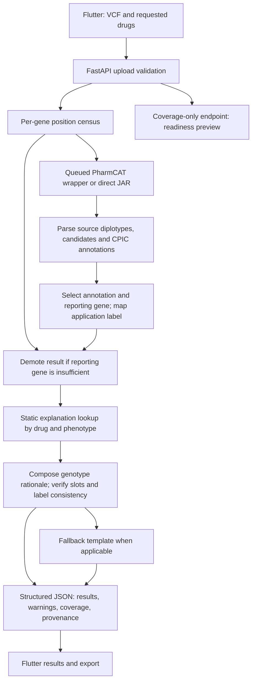
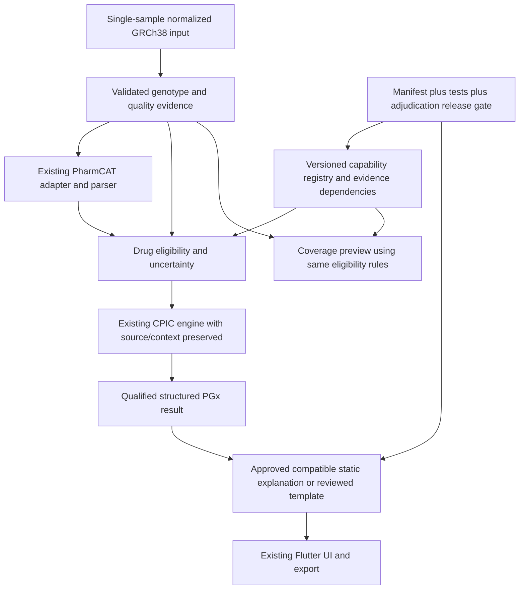

# Pharmacogenomic Risk Prediction System
## Final scientific audit and completion strategy

**Reviewed 23 September 2026 · Local commit `1dc7557da49f38e831b382545044b00a481507b6` · Research/educational scope**

This is an audit, not an implementation. Project source, tests, configuration and datasets were left unchanged. New experiments and this report are outside the repository. No dependencies were installed, no external patient data were submitted, and no changes were committed.

**Reading guide:** Sections 1, 15, 36 and 37 contain the decision and completion plan. Sections 7–13 establish scientific scope and validation. Sections 30–34 contain the complete gap, priority, experiment and dataset matrices. The closing Completion Decision states exactly what “complete” should mean.

**Evidence convention:** **R** = inspected repository; **X** = experiment run during this audit; **H** = historical repository report, inspected but not independently rerun; **S** = external scientific literature; **G** = authoritative guideline/tool/standards documentation; **A** = this audit's interpretation or recommendation. A passing software test is never presented as clinical validation. All recommendations use the unique priority IDs in section 31; later repetitions refer to the same recommendation, not additional scope.

# 1. Executive Summary

**The project is close to completion as a carefully bounded, deterministic genotype-to-PGx-guidance research demonstrator. It is not ready to claim reliable individualized drug-risk prediction. Most of its architecture should remain unchanged.**

The backend delegates allele calling to PharmCAT, maps bundled CPIC recommendations into application labels, checks genomic position sufficiency, and presents structured results with static, previously generated explanations. It does not learn a clinical outcome model, estimate an individual's adverse-event probability, or calculate warfarin doses. Its strongest components are the separation of deterministic interpretation from prose, explicit abstention, preservation of ambiguous/source diplotypes, real integration fixtures, and substantial reproducibility and adversarial-testing work. [R: main pipeline](</Users/bhuvant/Projects/Pharmacogenomic Risk Prediction System/backend/app/main.py:601>), [R: caller/parser](</Users/bhuvant/Projects/Pharmacogenomic Risk Prediction System/backend/app/pharmcat_runner.py:364>).

Fresh verification found **806 backend tests passing, 8 skipped; 194 Flutter tests passing; Flutter analysis with no issues**. These are strong engineering results. Nevertheless, targeted tests using the real local PharmCAT exposed failures outside the existing tests:

1. Removing every NUDT15 record still produces azathioprine **“Safe,” confidence 95%**, through the actual HTTP endpoint.
2. Explicitly failed FILTER records and very low DP/GQ still count as sufficient and produce confident labels; partial NUDT15 genotypes also produce “Safe.”
3. The API can return non-Unknown guidance for drugs beyond its advertised and audited six-drug scope.
4. One review script reports release-ready while adjudication reports **19 outstanding claims**; the deployment workflow does not depend on the backend quality workflow.
5. “Safe,” heuristic severity, and arbitrary numerical confidence communicate more clinical certainty than the evidence supports.

These are bounded defects at the input, decision, presentation and release boundaries. They do not justify replacing FastAPI, Flutter, PharmCAT, the corpus, or the explanation architecture. [X: endpoint results](</Users/bhuvant/.codex/visualizations/2026/09/23/01a0cc9a-c61d-7fa3-8fa1-1f312d9b1a66/pgx-audit/evidence/probe-final-results.json>), [X: genotype/quality probes](</Users/bhuvant/.codex/visualizations/2026/09/23/01a0cc9a-c61d-7fa3-8fa1-1f312d9b1a66/pgx-audit/evidence/probe-results.json>), [X: adjudication](</Users/bhuvant/.codex/visualizations/2026/09/23/01a0cc9a-c61d-7fa3-8fa1-1f312d9b1a66/pgx-audit/evidence/adjudication-status.json>).

The greatest scientific improvement is a **small independent external benchmark**, followed by a properly designed information-loss experiment. The repository's “n=1 external truth” is a limitation of its existing sample/table join, not of publicly available PGx truth. A June 2026 benchmark provides a practical starting point and substantially narrows novelty claims. [S: Gros-La-Faige et al., 2026](https://pubmed.ncbi.nlm.nih.gov/42312650/).

**Final recommendation:** six work packages, covering four P0 corrections and three P1 evidence/reliability tasks. Do not add genes, ML, live LLMs, EHR integration, or a second caller to production to finish this project. The “95%” estimate cannot be scientifically quantified, but a bounded completion path is realistic.

# 2. Repository State

| Item | Verified state |
|---|---|
| Authoritative workspace | `/Users/bhuvant/Projects/Pharmacogenomic Risk Prediction System` |
| Branch / commit | `main` / `1dc7557da49f38e831b382545044b00a481507b6` |
| Working tree | Clean before audit and at evidence capture; no project edits made |
| Local modifications relevant to interpretation | None in Git status; ignored reference data, local environment and generated historical artifacts are present |
| PharmCAT | Local JAR 3.4.0; bundled data `2026-07-13-11-40` |
| JAR integrity | SHA-256 `9317ef632bf6c9786ff0d9d455d4c9f6d2882ebd66ad7256b4ae958ddf454741`, matching the Docker check |
| Explanation store | 20 entries; generated `2026-07-24T09:53:53.175011+00:00` |
| Local Python / CI | 3.11.14 locally; workflow specifies Python 3.12 |
| Installed backend packages | FastAPI 0.121.2; Starlette 0.49.3; Pydantic 2.13.1; Uvicorn 0.40.0; python-multipart 0.0.20; PyYAML 6.0.3; httpx 0.28.1 |
| Test runtime | pytest 9.1.1 locally, differing from the development requirements pin of 8.4.2 |
| App | Flutter 3.38.9, Dart 3.10.8; local SDK matches workflow Flutter pin |
| Review date | 2026-09-23, Asia/Kolkata |

[X: exact versions and hashes](</Users/bhuvant/.codex/visualizations/2026/09/23/01a0cc9a-c61d-7fa3-8fa1-1f312d9b1a66/pgx-audit/evidence/audit-manifest.json>), [R: dependencies](</Users/bhuvant/Projects/Pharmacogenomic Risk Prediction System/backend/requirements.txt>), [R: CI](</Users/bhuvant/Projects/Pharmacogenomic Risk Prediction System/.github/workflows/test.yml>), [R: Docker](</Users/bhuvant/Projects/Pharmacogenomic Risk Prediction System/infra/Dockerfile>).

PharmCAT 3.4.0 is the latest release listed by its official release page at review, published 14 July 2026. There is no evidence-based reason to replace it merely to say the project uses a newer tool. A newer PharmVar database does not automatically imply the pinned PharmCAT bundle is unsuitable. [G: PharmCAT release](https://github.com/PharmGKB/PharmCAT/releases/tag/v3.4.0).

**Audit limits:** no fresh deployment, load test against the public site, dependency installation, clinical expert review, complete external-cohort reprocessing, penetration test, or wet-lab validation. Historical reports are explicitly distinguished from fresh measurements. Secret values were not inspected. This is a targeted deep audit, not proof that all defects have been found.

# 3. What Is Actually Implemented

| Component | Status | Actual behavior and limit | Repository evidence |
|---|---|---|---|
| VCF/gzip upload | Implemented but limited | Size/structure/build checks; GRCh38-oriented; accepts some invalid semantic cases | [validation](</Users/bhuvant/Projects/Pharmacogenomic Risk Prediction System/backend/app/vcf_validation.py>) |
| Evidence sufficiency | Implemented but limited | Per-gene required positions plus enforced critical-position sets; quality and drug dependency holes | [coverage](</Users/bhuvant/Projects/Pharmacogenomic Risk Prediction System/backend/app/coverage.py:158>) |
| Readiness preview | Implemented but limited | No JVM; gene-count preview and drug list; currently overstates answerability | [endpoint](</Users/bhuvant/Projects/Pharmacogenomic Risk Prediction System/backend/app/main.py:840>) |
| PharmCAT execution | Fully implemented for declared single-sample research path | Wrapper/JAR discovery, timeout, queue, temp cleanup; cancellation defect | [runner](</Users/bhuvant/Projects/Pharmacogenomic Risk Prediction System/backend/app/pharmcat_runner.py:219>) |
| Star-allele/diplotype parsing | Implemented but limited | Preserves source versus recommendation calls and candidates; depends on upstream definitions/input | [parser](</Users/bhuvant/Projects/Pharmacogenomic Risk Prediction System/backend/app/pharmcat_runner.py:530>) |
| CYP2D6 CNV/SV calling | Not implemented, intentionally withheld | No inference from plain uploaded VCF; codeine abstention | [runner exclusions](</Users/bhuvant/Projects/Pharmacogenomic Risk Prediction System/backend/app/pharmcat_runner.py:146>) |
| CPIC recommendation interpretation | Implemented but limited | Bundled CPIC annotations, ordered text rules, phenotype/label safeguards | [engine](</Users/bhuvant/Projects/Pharmacogenomic Risk Prediction System/backend/app/cpic_engine.py>) |
| Audited drug scope enforcement | Partially implemented | Six-drug UI/test scope but no equivalent API allowlist | [evaluate](</Users/bhuvant/Projects/Pharmacogenomic Risk Prediction System/backend/app/cpic_engine.py:646>) |
| Warfarin dosing | Not implemented | CYP2C9 result can exist; no validated multivariable dose calculation | [engine](</Users/bhuvant/Projects/Pharmacogenomic Risk Prediction System/backend/app/cpic_engine.py:646>) |
| Calibrated clinical risk | Not implemented | Fixed status-to-number confidence and editorial labels | [mapping](</Users/bhuvant/Projects/Pharmacogenomic Risk Prediction System/backend/app/data/label_mapping.yaml:487>) |
| Mechanism retrieval | Fully implemented for small corpus | Exact controlled-key lookup, six mechanism documents; no vector search | [retrieval](</Users/bhuvant/Projects/Pharmacogenomic Risk Prediction System/backend/app/retrieval.py>) |
| Static LLM explanations | Implemented but limited | Lookup by drug/phenotype, deterministic rationale, runtime slot/consistency checks | [explanation](</Users/bhuvant/Projects/Pharmacogenomic Risk Prediction System/backend/app/explanation/__init__.py:133>) |
| Runtime LLM mode | Experimental/optional | Provider path exists; default deployed static path avoids it | [generator](</Users/bhuvant/Projects/Pharmacogenomic Risk Prediction System/backend/app/explanation/generator_llm.py>) |
| Claim review/provenance | Partially implemented | Detailed records and tooling; review remains unfinished and release enforcement inconsistent | [adjudication](</Users/bhuvant/Projects/Pharmacogenomic Risk Prediction System/scripts/adjudication_status.py>) |
| Flutter web/mobile UI and export | Fully implemented within prototype scope | Upload, results, uncertainty, provenance, copy/export/print; percentage confidence is misleading | [app source](</Users/bhuvant/Projects/Pharmacogenomic Risk Prediction System/app/lib>) |
| Clinical context / phenoconversion | Not implemented | No patient-specific inhibitor/dose/organ-function interpretation | [request model and endpoint](</Users/bhuvant/Projects/Pharmacogenomic Risk Prediction System/backend/app/main.py:880>) |
| Clinical outcome ML | Not implemented | No outcome training/evaluation pipeline found | Backend, scripts, dependencies and model searches |
| FHIR/EHR integration | Not implemented | Application JSON/export, no verified FHIR profile or CDS Hooks integration | Backend/app model and export searches |
| External clinical validity/utility | Not established | Guideline evidence is external; this implementation has no clinical outcomes study | [validation report](</Users/bhuvant/Projects/Pharmacogenomic Risk Prediction System/reports/validation_report.md>) |
| Deployment/reproducibility | Implemented but limited | Docker, CI, backend/frontend commit matching and historical container checks; gates not unified | [deployment workflow](</Users/bhuvant/Projects/Pharmacogenomic Risk Prediction System/.github/workflows/deploy-web.yml>) |

“Fully implemented” describes existence and bounded behavior, not clinical certification. Absence judgments followed searches across implementation, scripts, reports, tests and dependencies.

# 4. Current Architecture

**R:** This diagram follows `analyze`, `assess`, `run_pharmcat`, `evaluate`, `build_result`, and `_static_result`. Coverage is computed before calling PharmCAT, but its abstention is applied afterward to the selected reporting gene. It does not currently prevent the caller from running. The optional live LLM path is an alternative explanation mode, not the decision engine. [pipeline](</Users/bhuvant/Projects/Pharmacogenomic Risk Prediction System/backend/app/main.py:880>), [postprocessing](</Users/bhuvant/Projects/Pharmacogenomic Risk Prediction System/backend/app/main.py:601>).

# 5. Documentation vs Reality

| Claim or impression | Verified reality | Consequence / recommendation |
|---|---|---|
| Risk prediction system | Guideline interpretation with heuristic categories; no outcome probability | Correct name/subtitle and claims, R3 |
| Six supported drugs | API evaluates report drugs without a matching explicit scope restriction | Enforce common capability registry, R2 |
| Coverage establishes an answerable drug | Only primary-gene sufficiency is considered; warfarin can be called answerable although final result is Unknown | Share drug eligibility between preview and analysis, R1/R2 |
| DPYD is the only gene with critical-position enforcement, in some comments | Shipped JSON also enforces all critical TPMT and NUDT15 positions | Update stale descriptions, not invent a missing engine, R6 |
| TPMT/NUDT15 minimum 80% | Critical sets span all their positions, making current effective requirement 100% | Document effective rule, R6 |
| External truth unavailable beyond n=1 | This is the old local join; later sources and a published benchmark offer more | Perform bounded new join, R5 |
| 100% integration fidelity | Agreement with PharmCAT fields, not independent biological truth or final gated accuracy | Preserve result with exact denominator, R6 |
| DPYD robustness in deletion study | DPYD was not varied to a deficient background | Withdraw broad inference; add pertinent controls, R6/R8 |
| Fully reviewed/explanation release ready | Provenance flags pass; 19 claim adjudications outstanding, no expert review | One enforceable release status, R4 |
| Genomic information never reaches a third party | True of intended static deployment, not optional live payload | Scope claim to runtime mode, R7 |
| Every execution confined to temp directory | Input/output files are; subprocess working directory/logs are not explicitly confined | Verify and confine logging, R7 |
| Runtime kills process group | Timeout kills direct process; cancellation leaves child alive in audit probe | Fix cancellation cleanup, R7 |
| Historical report statements describe current implementation | Earlier ungated cohort results and old label examples remain in reports | Date/version and supersession notices, R6 |

Evidence: [input documentation](</Users/bhuvant/Projects/Pharmacogenomic Risk Prediction System/docs/input_requirements.md>), [position data](</Users/bhuvant/Projects/Pharmacogenomic Risk Prediction System/backend/app/data/position_requirements.json>), [historical predeploy audit](</Users/bhuvant/Projects/Pharmacogenomic Risk Prediction System/reports/predeploy_audit_a.md>), [sensitivity script](</Users/bhuvant/Projects/Pharmacogenomic Risk Prediction System/scripts/measure_coverage_sensitivity.py:60>), [current status](</Users/bhuvant/Projects/Pharmacogenomic Risk Prediction System/PROJECT_STATUS.md>), [runner](</Users/bhuvant/Projects/Pharmacogenomic Risk Prediction System/backend/app/pharmcat_runner.py:456>).

# 6. Scientific Assessment

The causal chain is valid as a limited framework: measured genomic evidence → compatible allele interpretations → genotype-predicted function → applicable published guidance. Each arrow has independent assumptions. A correctly copied PharmCAT result does not prove the input was callable; a correct diplotype does not establish effective in-vivo metabolism; a published recommendation does not prove this software improves outcomes.

| Dimension | Judgment | Evidence boundary |
|---|---|---|
| Software correctness | Strong baseline, specific uncovered boundary defects | Fresh tests plus real counterexamples |
| Analytical validity | Limited | Tiny independent local truth set; broader synthetic/integration checks |
| Biological validity | Based on external allele/function and guideline resources | Not independently established for every input/allele by this project |
| External validity | Weakly characterized | No adequate current end-to-end truth benchmark across input types and ancestry |
| Clinical relevance | Credible for selected published gene–drug associations | Does not validate personalized action for an individual |
| Clinical utility | Not demonstrated for this implementation | No prospective outcomes or workflow study |
| Novelty | Potentially useful narrow systems/benchmark contribution | Not a new caller, new PGx association, or novel ML predictor |

**A:** Keep the deterministic foundation. Reframe the research around *when guideline interpretation is supported, how unsupported assertions are prevented, and whether explanations preserve the scope of the evidence*. This is more defensible than a global accuracy or patient-risk claim. PharmCAT itself describes limitations of missing evidence and its research-use scope. [G: PharmCAT disclaimers](https://pharmcat.clinpgx.org/Disclaimers/).

# 7. Genomic Input & Evidence Sufficiency

## What already works

The project already has a real sufficiency engine. It loads versioned position requirements, counts explicit reference calls, distinguishes variants-only suspicion, checks percentages and decision-critical positions, adds coverage metrics, and demotes results. Building a new “Genomic Evidence Sufficiency Engine” would duplicate existing work. [R: `assess`](</Users/bhuvant/Projects/Pharmacogenomic Risk Prediction System/backend/app/coverage.py:158>), [R: requirements](</Users/bhuvant/Projects/Pharmacogenomic Risk Prediction System/backend/app/data/position_requirements.json>).

| Gene | Required positions | Minimum percentage | Critical positions | Critical set enforced? | Effective current rule |
|---|---:|---:|---:|---|---|
| CYP2C19 | 35 | 100 | 31 | No | All 35 positions |
| CYP2C9 | 88 | 100 | 69 | No | All 88 |
| SLCO1B1 | 35 | 100 | 26 | No | All 35 |
| TPMT | 45 | 80 | 45 | Yes | All 45 |
| NUDT15 | 20 | 80 | 20 | Yes | All 20 |
| DPYD | 83 | 20 | 28 | Yes | All 28 critical positions; minimum implied fraction 33.7% |
| CYP2D6 | 157 | 100 | 140 | No | Position census only; clinical calling still withheld |

These are version-specific application sufficiency rules, not validated universal assay specifications. DPYD can have adequate assessed functional-position evidence while lacking enough information for an exact complete diplotype. Preserve that distinction.

## Verified weaknesses

`assess` reads the first sample-field token rather than locating `GT` through FORMAT. It recognizes a small set of complete no-call strings but counts `0/.` as called. It does not assess FILTER, DP, GQ, allele balance, REF/ALT identity, or phase support. A coordinate being present is not sufficient proof of a valid genotype. [R: coverage parsing](</Users/bhuvant/Projects/Pharmacogenomic Risk Prediction System/backend/app/coverage.py:174>).

**X:** All records with `FILTER=LowQual` still yielded four supported-drug “Safe” results. The same happened with DP=1 and GQ=1. Replacing NUDT15 calls with `0/.` preserved 100% measured NUDT15 coverage and azathioprine “Safe.” FORMAT containing only DP was accepted as complete coverage in the preflight probe; a downstream PharmCAT result was not tested for that malformed case. [probe data](</Users/bhuvant/.codex/visualizations/2026/09/23/01a0cc9a-c61d-7fa3-8fa1-1f312d9b1a66/pgx-audit/evidence/probe-results.json>), [partial-genotype downstream result](</Users/bhuvant/.codex/visualizations/2026/09/23/01a0cc9a-c61d-7fa3-8fa1-1f312d9b1a66/pgx-audit/evidence/probe-more-results.json>).

Official PharmCAT requirements assign quality filtering to the upstream pipeline: the caller ignores QUAL/FILTER and expects high-quality input. Consequently this is a missing application input contract, not evidence that PharmCAT promised to perform filtering and failed. A quality policy should distinguish explicit failure, missing quality metadata, and a declared prefiltered source; it should not invent a universal DP/GQ cutoff for every assay. [G: VCF requirements](https://pharmcat.clinpgx.org/using/VCF-Requirements/).

Other input boundaries:

- **Build:** GRCh37 declarations are intended to reject, but a GRCh38 accession takes precedence over a conflicting declaration. The mixed-header probe passed. Missing build is assumed with a warning. R1 should reject contradictions and require a defensible GRCh38 declaration or supported verification route.
- **Compression:** removing the final eight gzip bytes still passed validation; `_decompress` breaks on incomplete EOF instead of rejecting. Fix integrity validation, R1.
- **Multiple samples:** validator warns that the first sample will be analyzed, but real execution writes different report filenames and fails. Reject multisample uploads explicitly for this scope, R1.
- **Normalization:** direct-JAR mode does not establish equivalent normalization to the optional preprocessor. Admit only the documented normalized input contract or explicitly preprocess with pinned reference resources. Do not implement guessed liftover or silent allele repair.
- **gVCF:** no verified END-block expansion/callability interpretation in the sufficiency engine. Do not count block absence as reference. Keep native gVCF ingestion outside current scope; document supported upstream conversion.
- **Variants-only:** zero explicit reference calls is a useful warning heuristic, not a proof of file origin. A sparse all-variant target panel could satisfy the heuristic for different reasons.

[R: build detection](</Users/bhuvant/Projects/Pharmacogenomic Risk Prediction System/backend/app/vcf_validation.py:195>), [R: decompression](</Users/bhuvant/Projects/Pharmacogenomic Risk Prediction System/backend/app/vcf_validation.py:244>), [R: multisample handling](</Users/bhuvant/Projects/Pharmacogenomic Risk Prediction System/backend/app/vcf_validation.py:426>), [G: preprocessor behavior](https://pharmcat.clinpgx.org/using/VCF-Preprocessor/).

**R1 minimum:** validate usable genotype evidence at each required position; keep missing, failed and unverified evidence distinct; evaluate the *drug's relevant gene set*, not just the display gene. Exact positional percentages alone cannot carry the scientific claim.

# 8. Pharmacogene Calling

For CYP2C19, CYP2C9, SLCO1B1, TPMT and NUDT15, the existing workflow can interpret known small variants when the accepted input contract is met. “Simple gene” is a relative engineering description: compound heterozygosity, rare variants, phase and definition changes still matter. DPYD especially requires separating functional-variant evidence from full haplotype resolution.

The parser's separation of **source diplotypes** from recommendation-oriented representations is an important strength. Multiple compatible diplotypes are retained, and the phenotype resolver can distinguish ambiguous identity from a shared functional interpretation. Avoid replacing this with a single convenient diplotype. Validate cases containing both informative and unresolved candidates so unknown candidates cannot accidentally disappear from the justification. [R: parser](</Users/bhuvant/Projects/Pharmacogenomic Risk Prediction System/backend/app/pharmcat_runner.py:530>), [R: phenotype resolution](</Users/bhuvant/Projects/Pharmacogenomic Risk Prediction System/backend/app/cpic_engine.py:219>), [R: source-diplotype tests](</Users/bhuvant/Projects/Pharmacogenomic Risk Prediction System/backend/tests/test_diplotype_source.py>).

**CYP2D6 abstention is correct for this implementation.** CNVs, hybrid alleles, pseudogene homology and copy-specific phase cannot be reconstructed merely by inspecting a list of SNVs in the uploaded file. The current path deliberately does not attempt a clinical CYP2D6 call, even if positions are present. Adding a percentage threshold or another regex would not solve this. Specialized read-level methods such as Cyrius or long-read StarPhase use materially different evidence. [G: Cyrius](https://github.com/Illumina/Cyrius), [G: StarPhase](https://github.com/PacificBiosciences/pb-starphase).

PharmVar is a nomenclature and allele-definition source, not an outcome model or substitute for calling. Its current site reports **6.2.28, updated 31 July 2026**. Changes should enter through a frozen, tested interpretation bundle; mixing new allele names with old functions and old explanation keys can create inconsistency. [G: PharmVar](https://www.pharmvar.org/).

**Current-source delta, verified during final review:** a July 31, 2026 paper and August 7 ClinPGx notice revise the CYP2C19 *2 core definition: c.681G>A is the defining core change, with newly recognized haplotypes lacking previously assumed companion variants. This also makes phase relevant to distinguishing certain *1/*2 and *2/*35 possibilities. The pinned JAR still encodes the older companion-base requirements. [S: Turner et al., 2026](https://pubmed.ncbi.nlm.nih.gov/42535320/), [G: definition-update notice](https://blog.clinpgx.org/cyp2c19-2-core-allele-definition-update/).

**X:** A complete-position synthetic input carrying only homozygous c.681G>A against the demo reference background produced CYP2C19/clopidogrel **Unknown** in the current real caller. This is a demonstrated coverage limitation for the newly recognized pattern, not a demonstrated false reassurance or independent biological validation. R6 should record the definition delta and include it in controlled upgrade regression tests; do not hand-edit one allele into an otherwise incompatible bundle. [Version probe](</Users/bhuvant/.codex/visualizations/2026/09/23/01a0cc9a-c61d-7fa3-8fa1-1f312d9b1a66/pgx-audit/evidence/probe-version-results.json>).

**A:** Preserve current caller and abstentions. External precalled CYP2D6/SV results could be a future bounded adapter (R12/P4), requiring assay/source/version validation and explicit provenance. Do not add it to the final 5%.

# 9. Current Gene–Drug Coverage

| Advertised drug | Required PGx context for current intended interpretation | Current actual behavior | Completion scope |
|---|---|---|---|
| Clopidogrel | CYP2C19; recommendation applicability includes indication | Produces guideline-derived labels when gene passes | Keep; preserve indication qualification |
| Simvastatin | SLCO1B1 | Produces guidance; transporter function compressed into metabolizer enum | Keep; display proper raw/function terminology |
| Azathioprine | TPMT **and NUDT15** for a complete paired interpretation | Reporting gene can be TPMT or NUDT15; missing partner can fail to gate | Keep after R1 |
| Fluorouracil | DPYD functional evidence and appropriate recommendation context | Produces guidance if critical set passes | Keep; avoid claiming absence of all DPD deficiency |
| Warfarin | More than CYP2C9; validated dosing requires genetic and clinical inputs | Current full-coverage demo returns Unknown; no dose algorithm | Explicit limited/unsupported-dose result |
| Codeine | Adequately resolved CYP2D6 | Current upload path returns Unknown/not attempted | Explicit unsupported-gene result |

**Important distinction:** there are six advertised drugs, four with non-Unknown guidance on the normal demo, and a larger accidental runtime surface. These are not equivalent counts of validated capabilities.

**X:** The normal real PharmCAT report contained 88 drug entries. Passing each through the same response builder yielded 19 non-Unknown results: atorvastatin, azathioprine, capecitabine, clopidogrel, dexlansoprazole, fluorouracil, fluvastatin, fosphenytoin, lansoprazole, lovastatin, mercaptopurine, omeprazole, pantoprazole, phenytoin, pitavastatin, pravastatin, rosuvastatin, simvastatin and thioguanine. Fifteen are outside the advertised six. The actual API confirmed atorvastatin “Safe” and phenytoin “Adjust Dosage.” The other 69 being Unknown in this one background does not prove they can never produce a label. [X: complete sweep](</Users/bhuvant/.codex/visualizations/2026/09/23/01a0cc9a-c61d-7fa3-8fa1-1f312d9b1a66/pgx-audit/evidence/probe-more-results.json>), [X: HTTP confirmation](</Users/bhuvant/.codex/visualizations/2026/09/23/01a0cc9a-c61d-7fa3-8fa1-1f312d9b1a66/pgx-audit/evidence/probe-final-results.json>).

Some additional guidelines depend on evidence the prototype does not assess, such as HLA or other transporter genes. Treating every annotation the upstream tool returns as an audited application capability is unjustified. R2 should constrain analysis, preview, UI, export, corpus and mapping validation to one declared scope. Do not spend the final 5% validating the accidental expansion.

# 10. Guideline Engine

The engine reads CPIC annotations from the PharmCAT report, matches them to called phenotypes, selects a reporting gene, and applies ordered rules over recommendation/implication text. It also contains phenotype/label invariants and contradiction detection. CPIC source text and application summary labels must remain visibly distinct. [R: annotation matching](</Users/bhuvant/Projects/Pharmacogenomic Risk Prediction System/backend/app/cpic_engine.py:445>), [R: classification](</Users/bhuvant/Projects/Pharmacogenomic Risk Prediction System/backend/app/cpic_engine.py:357>).

**X:** The existing mapping validator reported **105 combinations, 92 agreements (87.6%), 13 disagreements**. These are recorded accepted divergences, not 13 newly discovered defects. The expected-label heuristic itself sometimes calls “no dosing flag” Safe, even when the source says phenotype is unknown. This is an internal mapping-consistency exercise, not 87.6% clinical accuracy and not a validated gold standard. [validator output](</Users/bhuvant/.codex/visualizations/2026/09/23/01a0cc9a-c61d-7fa3-8fa1-1f312d9b1a66/pgx-audit/evidence/label-validation.json>), [accepted divergences](</Users/bhuvant/Projects/Pharmacogenomic Risk Prediction System/reports/label_mapping_accepted_divergences.json>).

Current source review:

| Resource | Date/version checked | Implication |
|---|---|---|
| PharmCAT bundle | 3.4.0 / data 2026-07-13-11-40 | Freeze current coherent baseline |
| CPIC thiopurines | 2025 update published 2026, PMID 41618934 | Combined TPMT/NUDT15 states matter; local material already cites this update |
| CPIC DPYD | July 9, 2026 advisory about pending update | Track separate from finalized database; do not silently rewrite frozen rules |
| CPIC clopidogrel / statins | Local corpus cites 2022 updates | Record exact source row/version; no newer finalized replacement established in this audit |
| CPIC warfarin | 2017 guideline | Confirms current CYP2C9-only result is not a complete dosing implementation |

[G: thiopurine update](https://files.cpicpgx.org/data/guideline/publication/thiopurines/2026/41618934.pdf), [G: DPYD pending update](https://blog.clinpgx.org/cpic-comment-on-pending-dpyd-guideline-update/), [G: warfarin](https://pmc.ncbi.nlm.nih.gov/articles/PMC5546947/).

A separate thiopurine erratum (online April 28, 2026; ClinPGx notice May 13) corrects TPMT no-function plus decreased-function terminology from Possible Intermediate Metabolizer to Intermediate Metabolizer; the notice states their therapeutic recommendations are the same. The local bundle still labels TPMT *2/*8 “Possible Intermediate Metabolizer.” The application maps that to IM, so this check identifies source/terminology drift rather than proving a different treatment recommendation. [G: correction notice](https://blog.clinpgx.org/correction-to-cpic-guideline-update-for-tpmt-nudt15-and-thiopurines/), [G: published erratum](https://pubmed.ncbi.nlm.nih.gov/42050374/), [X/R: bundle extraction](</Users/bhuvant/.codex/visualizations/2026/09/23/01a0cc9a-c61d-7fa3-8fa1-1f312d9b1a66/pgx-audit/evidence/thiopurine-correction-bundle-check.json>).

The DPYD advisory concerns a specific HapB3 causal variant and says database changes wait for publication of the full guideline. A pending advisory should be recorded and checked before a release, not generalized to every allele sharing an earlier activity value. No later finalized DPYD update was verified during this audit.

**R3/R6:** preserve indication, recommendation strength, source identifier, phenotype context and bundle version. Do not infer severity merely from “poor metabolizer” across different mechanisms. Do not automatically merge CPIC, DPWG and FDA into an apparent consensus: discrepancies should be attributed to source, indication and date. A full conflict engine is future work (R13/P4); the present application can accurately state that it implements its pinned CPIC path.

# 11. Validation Audit

| Layer | Evidence | What it establishes | What it does not establish |
|---|---|---|---|
| Software | X: 806 backend passes, 8 skips; 194 app passes; analyzer clean | Broad regression/invariant coverage in tested environment | Correctness of all inputs or clinical claims |
| Integration concordance | H: 400 samples, 5,600 field comparisons, reported perfect agreement | Wrapper/parser preserves selected upstream fields | Independent genotype truth, final drug-gate correctness |
| Constructed allele sweep | H: 503 allele cases; 331 callable: 320 exact, 2 equivalent suballeles, 9 other-gene-primary outcomes; 172 CYP2D6 withheld | Internal consistency over extensive constructed homozygous cases | All diplotypes, compound heterozygotes, rare/SV biology, external accuracy |
| External analytical comparison | H: usable GeT-RM join n=1 (NA12273), two supported genes in that join | A real independent anchor and abstention control | General analytical validity or broad population accuracy |
| Coverage stress | H: 120 synthetic columns from 2 backgrounds × 5 levels × 12 masks | Missing positions can change confident caller results in tested backgrounds | 120 independent patients; robust DPYD deficiency detection |
| Population survey | H: 601 SAS raw PharmCAT results; same upload gate withholds them | Exploratory distribution of raw calls and input inadequacy | 601 externally validated drug recommendations |
| Explanation checks | H/X: guard, slot, consistency, provenance and adjudication tooling | Specific mechanical/lexical checks and review traceability | Semantic completeness or clinical expert validation |
| Clinical validity/utility | None established for application | Reliance on published association/guideline evidence | Patient benefit, safety, dosing efficacy, deployment outcomes |

[X: backend log](</Users/bhuvant/.codex/visualizations/2026/09/23/01a0cc9a-c61d-7fa3-8fa1-1f312d9b1a66/pgx-audit/evidence/backend-tests.txt>), [X: Flutter log](</Users/bhuvant/.codex/visualizations/2026/09/23/01a0cc9a-c61d-7fa3-8fa1-1f312d9b1a66/pgx-audit/evidence/flutter-tests.txt>), [X: analyzer](</Users/bhuvant/.codex/visualizations/2026/09/23/01a0cc9a-c61d-7fa3-8fa1-1f312d9b1a66/pgx-audit/evidence/flutter-analysis.txt>), [H: validation](</Users/bhuvant/Projects/Pharmacogenomic Risk Prediction System/reports/validation_report.md>), [H: allele sweep](</Users/bhuvant/Projects/Pharmacogenomic Risk Prediction System/reports/constructed_allele_sweep.md>), [H: SAS expansion](</Users/bhuvant/Projects/Pharmacogenomic Risk Prediction System/reports/sas_cohort_expansion.md>).

**Methodological corrections (R6/P1):**

- The coverage study's “variant” background changes five genes but not DPYD. Its zero DPYD errors do not establish robustness for deficient DPYD genotypes.
- The reported wrong-confident denominator is `correct + wrong_confident`, conditional on asserted calls. Do not relabel this as the fraction of all samples.
- Random deletion is not a proven upper bound on structured missingness. Targeted loss of an actionable site can be much worse at the same percent coverage.
- Replicated masks of two genomes do not supply 120 independent biological observations. Use sample/genotype clusters in inference.
- “n≥30” is not an adequate universal statistical justification, and overlapping confidence intervals are not a formal equivalence test.
- Synthetic alleles derived from the same caller definitions are useful tests but circular evidence for real biological accuracy.
- Frequency plausibility is not individual-level correctness. Post-filter frequency discrepancies cannot be called genuine population deviations without addressing ambiguity, ascertainment, comparator uncertainty and relatedness.

The app test suite was run in an isolated copy. Initial missing-fixture failures were caused by the audit copy setup; after copying the existing demo fixtures, all 194 passed. This is not recorded as a project defect. Backend skips were retained, not converted into passes. No fresh clinical validation is claimed.

# 12. External Ground Truth

The local project deserves credit for saying n=1 rather than inflating its validation. The next step is to revisit the data source, not accept n=1 as an immutable ceiling.

CDC's current resource page lists a **363-sample consolidated PGx/HLA consensus resource across 34 loci**, updated consensus for 137 samples, a 33-cell-line DPYD resource, a 30-cell-line TPMT/NUDT15 resource, and public WGS FASTQ/BAM data for 70 samples. The sequencing accession is **PRJEB19931**. Not every sample has truth for every gene. [G: CDC GeT-RM, page dated September 10, 2024](https://www.cdc.gov/lab-quality/php/get-rm/reference-materials.html), [G: ENA accession](https://www.ebi.ac.uk/ena/browser/view/PRJEB19931).

A 2026 caller benchmark used **88 overlapping GeT-RM/1000 Genomes individuals** and **682 diplotype comparisons across nine genes** after its inclusion decisions. Its curated truth and scripts provide an immediate reproducible lead. The small NUDT15 overlap illustrates why a large pooled count must not hide gene-specific sparsity. [S: benchmark](https://pubmed.ncbi.nlm.nih.gov/42312650/), [S: companion repository](https://github.com/marcglf/benchmark-star-allele-callers).

**R5/P1 minimum:** make a transparent sample × gene × source join with explicit exclusion reasons and truth versions. Start with this published cohort, then targeted TPMT/NUDT15 or DPYD references if needed. Distinguish three layers: available consensus labels, downloadable genomic data, and genomic data satisfying the application's evidence contract. Never synthesize missing reference observations from a truth label just to make a sample pass.

The consolidated CDC spreadsheet was identified but not downloaded successfully through the browsing tool; its entire row-level contents were not audited. The proposed expanded benchmark has not been executed here. Dataset availability is a verified route, not a claimed new validation result.

# 13. State-of-the-Art Comparison

| Tool/resource | Evidence/input and role | Version/date verified | Relevance to this project | Decision |
|---|---|---|---|---|
| PharmCAT | Normalized genotype VCF and optional outside calls; CPIC interpretation/reporting | 3.4.0, July 14, 2026 | Best fit to existing architecture; application must enforce input and scope | Keep |
| PyPGx | Sequencing/array workflows; allele and SV inference with resource bundle | 0.27.0, June 12, 2026 | Useful external research comparator; broader workflow than upload interpreter | Offline comparison only, R8 |
| Aldy | Read-based allele/copy-number inference | Tool verified; latest package version not independently established here | Different required evidence; compare on matched input if research expands | No production replacement |
| Cyrius / ursaPGx | Specialized CYP2D6 read-level analysis / broader pipeline | Current repositories; exact latest version not asserted | Addresses complex-gene evidence unavailable to present API | R12 future work |
| pb-StarPhase | Phase-aware PacBio diplotyping, including complex loci | 2.2.0, July 30, 2026; database 20260724 | Strong long-read comparator/reference route; not a drop-in plain-VCF engine | R12 future work |
| PharmVar | Allele definitions and nomenclature | 6.2.28, July 31, 2026 | Source-version discipline, no calling or clinical outcome guarantee | Pin through bundle |
| CPIC / ClinPGx | Evidence and prescribing guideline knowledge | Guideline-specific versions | Interpretation authority with context, not software validation | Keep exact provenance |

[G: PyPGx release](https://pypi.org/project/pypgx/0.27.0/), [G: Aldy](https://github.com/0xTCG/aldy), [G: Cyrius](https://github.com/Illumina/Cyrius), [G: StarPhase release](https://github.com/PacificBiosciences/pb-StarPhase/releases).

Published caller rankings depend on gene, data modality, definitions, truth revisions and handling of abstentions. They do not imply that replacing a tool automatically improves this application. An offline comparator must receive equivalent usable evidence and report coverage as well as concordance. No new caller was installed or benchmarked in this audit.

Recent long-read work supports the importance of phase/SVs and also shows reference labels can be refined. A 2025 targeted adaptive-sampling PGx study and a 2025 diverse long-read population resource are relevant future validation routes, not reasons to add a sequencing pipeline to this release. [S: targeted long-read PGx, 2025](https://www.nature.com/articles/s41598-025-22941-z), [S: diverse long-read genomes, 2025](https://www.nature.com/articles/s41586-025-09290-7).

# 14. Major Strengths

1. **Deterministic authority:** genomic/CPIC decisions do not depend on an LLM.
2. **Real abstention machinery:** coverage, critical positions, unsupported CYP2D6 and phenotype invariants are implemented.
3. **Source fidelity:** source versus recommendation diplotypes and ambiguity receive explicit handling.
4. **Small exact corpus:** controlled-key retrieval is appropriate for six curated mechanism documents.
5. **Separation of prose and facts:** genotype rationale is code-composed; static text avoids runtime model drift, cost and patient-data exposure in the intended deployment.
6. **Unusually candid internal reports:** many documents explicitly identify circular validation, n=1 truth and lexical guard limitations.
7. **Substantial verification:** large backend/app suites, real upstream fixtures, accepted-divergence records and historical deployment/resource measurements.
8. **Useful operational controls:** concurrency gate, bounded waiting, timeout, explicit CORS, secret checks, temp directories and commit matching.

These are repository strengths, not assertions of clinical readiness. Preserve them. [R: tests](</Users/bhuvant/Projects/Pharmacogenomic Risk Prediction System/backend/tests>), [R: explanation composition](</Users/bhuvant/Projects/Pharmacogenomic Risk Prediction System/backend/app/explanation/compose.py>), [R: security](</Users/bhuvant/Projects/Pharmacogenomic Risk Prediction System/backend/app/security.py>), [H: provenance limitation report](</Users/bhuvant/Projects/Pharmacogenomic Risk Prediction System/reports/provenance_finding.md>).

# 15. Critical Weaknesses

| Priority ID | Finding | Evidence strength | Why it blocks a defensible completion |
|---|---|---|---|
| R1/P0 | Validity of counted genotypes and multigene drug sufficiency | Real caller + HTTP counterexample | Missing or failed evidence can still yield a reassuring drug result |
| R2/P0 | No single audited capability boundary | Real caller sweep + HTTP counterexample | Results extend beyond validated drugs/co-genes/explanations |
| R3/P0 | “Safe,” arbitrary 95% confidence and generic severity | Code + rendered UI text + returned explanation | Presentation implies precision/safety not measured by the system |
| R4/P0 | Incomplete explanation adjudication and bypassable release gate | Fresh scripts + workflow inspection | The system can ship text its own review process says is not ready |
| R5/P1 | Independent analytical evidence remains tiny | Historical validation plus new external sources | Cannot substantiate broad accuracy |
| R6/P1 | Methods, claims and version bundle are inconsistent | Script/report inspection | Research conclusions can exceed actual denominators and sampling |
| R7/P1 | Cancellation and input-resource/logging boundaries | Controlled child-process probe + code | Resource ownership and privacy promises are incompletely enforced |

The highest-priority issue is **not missing AI**. It is that evidence insufficiency is not consistently propagated all the way into a drug-specific claim and its explanation.

# 16. Hidden Failure Modes

| Case | Observation | Status |
|---|---|---|
| All NUDT15 rows removed, TPMT normal | NUDT15 0/20; azathioprine HTTP 200, Safe, 0.95 | Confirmed |
| All TPMT rows removed, NUDT15 normal | Azathioprine Unknown | Confirmed asymmetry |
| All calls explicitly FILTER-failed | Coverage passes; four intended actionable drugs Safe | Confirmed |
| DP=1/GQ=1 everywhere | Same confident results | Confirmed; appropriate quality policy still assay-dependent |
| NUDT15 `0/.` | Coverage counts as complete; azathioprine Safe | Confirmed |
| FORMAT=DP, sample=30 | Coverage counts as genotyped | Preflight only; downstream result not tested |
| Mixed GRCh37 declaration/GRCh38 accession | Accepted as GRCh38 | Preflight confirmed |
| Truncated gzip trailer | Accepted full decoded input | Preflight confirmed |
| Two samples | Accepted with first-sample warning; runner cannot locate expected output | Real caller failure confirmed |
| Drug outside documented scope | Atorvastatin Safe; phenytoin Adjust Dosage via API | Confirmed |
| Cancel subprocess task | Child remains alive after cancellation; audit cleaned up its own child | Confirmed using harmless sleeping process |
| Static explanation keyed only by drug/phenotype | Gene, combined state and indication are not part of key | Design limitation; particular wrong-gene prose not universally demonstrated |
| Missing partner with generic normal explanation | Prose describes normal enzyme function and “safe risk” despite incomplete evidence | Confirmed in NUDT15 deletion |
| Historical “full coverage” interpreted as all genomic variation tested | Requirements cover a finite known set only | Scientific overinterpretation risk, not a new observed caller error |

[X: first probes](</Users/bhuvant/.codex/visualizations/2026/09/23/01a0cc9a-c61d-7fa3-8fa1-1f312d9b1a66/pgx-audit/evidence/probe-results.json>), [X: additional probes](</Users/bhuvant/.codex/visualizations/2026/09/23/01a0cc9a-c61d-7fa3-8fa1-1f312d9b1a66/pgx-audit/evidence/probe-more-results.json>), [X: final endpoint/cancellation probe](</Users/bhuvant/.codex/visualizations/2026/09/23/01a0cc9a-c61d-7fa3-8fa1-1f312d9b1a66/pgx-audit/evidence/probe-final-results.json>). Synthetic data were used throughout. These probes demonstrate behavior, not measured patient-harm rates.

# 17. Uncertainty & Abstention

The system already represents caller status, phenotype, candidate diplotypes, coverage, warnings, missing evidence, guideline provenance and Unknown outputs. The improvement should reuse those fields and add a compact reason structure where needed, rather than replace every model.

| Uncertainty | Appropriate representation | Current gap / action |
|---|---|---|
| Invalid input | Analysis rejected with stable reason | FORMAT/build/compression/sample checks, R1 |
| Evidence missing | Per-gene missing positions; per-drug required evidence | Propagate all relevant genes, R1 |
| Quality failed or unverified | Explicit quality state/source contract | Currently conflated with observed position, R1 |
| Diplotype ambiguity | Candidate set and call status | Largely present; preserve it |
| Shared phenotype across candidates | “Identity unresolved; assessed candidates share function” | Do not convert to definite genotype |
| Function unknown/indeterminate | No unsupported functional assertion | Preserve unresolved candidates and reason |
| Unsupported gene or drug | Capability-specific abstention | Common registry, R2 |
| Guideline context absent | Partial/context-dependent guidance | Preserve source conditions, R3 |
| Guideline strength | Source's recommendation strength | Keep separate from application certainty |
| Clinical outcome uncertainty | No personalized probability estimated | Remove arbitrary percent display, R3 |

Use reason codes such as `missing_required_gene`, `partial_genotype`, `failed_quality_filter`, `unsupported_gene`, `unsupported_drug`, `ambiguous_function` and `context_not_assessed` as an additive design proposal (R1–R3). Keep the detailed evidence behind those reasons. A successful HTTP analysis may legitimately contain an unsupported or indeterminate drug result; distinguish process success from scientific answerability.

**Metrics for a deterministic selective system:** for N evaluable cases, A asserted calls and E erroneous asserted calls, report assertion coverage A/N and conditional error E/A. Also report E/N. Define false reassurance separately as a reassuring result among independently established actionable cases; show its denominator explicitly. Abstaining on everything yields zero observed asserted errors but no useful service. “Coverage” here means fraction answered, distinct from percentage of required genomic positions observed.

Selective prediction/reject-option research supplies the risk-versus-coverage framing. It does not require the prototype to train a neural network. Conformal coverage guarantees also require a suitable labeled calibration setting and assumptions; neither is supplied by arbitrary fixed confidence scores or two synthetic backgrounds. **DROP conformal probability claims for this release.** [S: selective classification, Geifman and El-Yaniv, 2017](https://arxiv.org/abs/1705.08500), [S: classification with valid/adaptive coverage, Romano et al., 2020](https://arxiv.org/abs/2006.02544).

# 18. Population Representation

The SAS work is useful because it surfaces input and sampling limitations. It is not a demonstration of Indian clinical performance. The 601-sample expansion covers the five 1000 Genomes SAS population labels (BEB, GIH, ITU, PJL, STU); neither these labels nor a pooled SAS estimate represent all Indian subpopulations. The report itself acknowledges that current evidence gates withhold all these uploaded cohort files. [H: SAS report](</Users/bhuvant/Projects/Pharmacogenomic Risk Prediction System/reports/sas_cohort_expansion.md>).

`sas_frequencies.read_reports` takes the first source diplotype and first phenotype. That can understate ambiguous-call uncertainty in a population analysis even though production preserves candidates. The expanded cohort also requires a relatedness check, because treating relatives or two chromosomes from the same person as independent can narrow intervals inappropriately. These are methodological reasons to avoid describing post-filter differences as proven population biology. [R: frequency extraction](</Users/bhuvant/Projects/Pharmacogenomic Risk Prediction System/scripts/sas_frequencies.py:88>), [H: filtered deviations](</Users/bhuvant/Projects/Pharmacogenomic Risk Prediction System/reports/sas_deviation_filtered.md>).

Relevant primary resources include **IndiGenomes (1,029 Indian genomes)** and the **GenomeAsia pilot (1,739 individuals, 219 population groups)**. They support diversity-aware allele ascertainment and frequency comparisons; their population variant frequencies are not individual PGx diplotype truth. GenomeAsia's published access description separates open summary data from application-based individual-level access. [S: IndiGenomes, 2020/2021](https://pmc.ncbi.nlm.nih.gov/articles/PMC7778947/), [S: Indian PGx landscape](https://pmc.ncbi.nlm.nih.gov/articles/PMC9010271/), [S: GenomeAsia, 2019](https://www.nature.com/articles/s41586-019-1793-z).

**R6/P1:** correct the population claims and ambiguous-call denominator now. **R10/P2:** later stratify the independent benchmark by available population labels and input completeness, report per-stratum n and intervals, and retain inconclusive findings when rare functional alleles are absent. Use exact, candidate-set-aware and phenotype-level comparisons; exclude relatives or cluster them as the data require. Do not infer an individual's genetic ancestry from a broad label, tune clinical rules by presumed ethnicity, or impute missing patient evidence from population frequencies.

# 19. Clinical Context & Phenoconversion

The current input is VCF plus drugs. It does not assess age, renal/hepatic function, current inhibitors/inducers, dose, indication, prior toxicity or laboratory results. Consequently outputs should say **genotype-predicted phenotype and published PGx guidance under stated conditions**, rather than effective observed metabolism or complete prescribing advice.

Phenoconversion is a real distinction: inhibitor exposure can change effective CYP2D6 function relative to genotype prediction. CPIC's 2024 beta-blocker guideline addresses this context. It does not justify a generic adjustment applied identically to every gene and medicine. [G: CPIC beta-blockers, 2024](https://files.cpicpgx.org/data/guideline/publication/beta_blockers/2024/38951961.pdf).

**R3/P0:** ensure summaries preserve indication and dose qualifiers and state what was not assessed where it affects interpretation. **R13/P4:** a future structured medication/context module could use source-specific, reviewable rules, with separate tests for inhibitor potency, exposure timing, combinations and guideline applicability. It is not part of the final 5% because current CYP2D6 interpretation is deliberately withheld and the project lacks a validated context dataset.

Warfarin makes the boundary especially clear. Established pharmacogenetic dosing approaches use additional genes/variants and clinical variables, with INR-guided management; a CYP2C9 label is insufficient. Preserve the current no-dose behavior. Do not train another warfarin model without independent dose/outcome labels, baseline IWPC/Gage and clinical-only comparators, an external cohort, leakage controls, subgroup evaluation and dose-error calibration. Those requirements would create a separate project. [G: CPIC warfarin, 2017](https://pmc.ncbi.nlm.nih.gov/articles/PMC5546947/).

# 20. AI / ML Assessment

| Candidate use | Exact problem and evidence available | Deterministic baseline | Decision |
|---|---|---|---|
| Outcome/adverse-event prediction | No local independent clinical outcome training set | Source-specific guideline interpretation | D1/DROP |
| Warfarin dose ML | No demonstrated dose dataset or external validation path in project | Established pharmacogenetic and clinical dosing algorithms | D1/DROP for current project |
| Learn sufficiency from deletion data | Current labels are caller/self-definition based and tiny in biological diversity | Correct genotype parsing + critical-position/dependency rules | D2/DROP for completion |
| Clinical label assignment with an LLM | Problem is source applicability and faithful deterministic mapping | Existing CPIC engine | D3/DROP |
| Explanation drafting offline | Small curated corpus and structured cases; current infrastructure exists | Deterministic templates | Keep only with R4 review/fallback |
| LLM semantic verification | Could miss plausible unsupported meaning; no independent broad validation | Human claim adjudication and source comparison | R9/P2 evaluation only; not authoritative gate |
| Complex-gene callers containing statistical models | Different raw evidence and specialized validation | Current abstention | R12/P4 integration research |

For rejected predictive proposals, the essentials are absent: reliable independent outcome labels, adequate sample size, separated development/test patients, leakage prevention, a baseline to beat, external calibration and distribution-shift evaluation. More synthetic data derived from the current mapping does not solve those deficits. The final project is stronger when its decision authority stays deterministic.

# 21. LLM Safety & Explanation Architecture

The default static path is appropriate. Its useful structure is: deterministic result → stored generic prose → deterministic genotype rationale → runtime slot and label checks → fallback. The optional live mode uses the same context to query a provider; it is not required for deployed functionality. [R: explanation dispatch](</Users/bhuvant/Projects/Pharmacogenomic Risk Prediction System/backend/app/explanation/__init__.py:279>).

| Approach | Faithfulness and operational tradeoff | Assessment |
|---|---|---|
| Deterministic templates | Stable, reviewable, low cost/latency; can still encode an incorrect broad statement | Strong default/fallback |
| Pregenerated, actually reviewed prose | Better phrasing with fixed outputs and known source versions; review work scales with semantic cases | Best optional enhancement here |
| Retrieval-grounded runtime generation | Retrieves evidence but still may alter qualifiers or causal meaning | No current necessity |
| Runtime LLM + verifier | Adds privacy, latency, stochasticity and correlated-verifier failure | Keep disabled for public release |
| Current hybrid | Good division of responsibility, incomplete content approval and case identity | Repair R4; no redesign |

**Actual limits of existing defenses:** entity guards can reject an invented drug, gene or number, but sourced terms can still be assembled into wrong causal meaning. Slot checks verify substituted facts, not whether generic prose applies to the combined genotype. Label consistency cannot repair an upstream label that was itself based on incomplete evidence.

The historical model benchmark used five candidates and only three cases each. Its selected model had a reported guard pass rate of 100% but provenance pass rate of 0% in that initial benchmark; later curation is a separate artifact. The 12-run adversarial experiment and five planted detector violations are useful instrumentation checks, not broad estimates of hallucination probability. The repository correctly documents many of these limitations. [H: model benchmark](</Users/bhuvant/Projects/Pharmacogenomic Risk Prediction System/reports/model_benchmark.md>), [H: adversarial experiment](</Users/bhuvant/Projects/Pharmacogenomic Risk Prediction System/reports/guard_experiment.md>), [H: detector study](</Users/bhuvant/Projects/Pharmacogenomic Risk Prediction System/reports/detector_sensitivity.md>).

**R4/P0:** serve only approved, context-compatible static entries; otherwise use a reviewed deterministic template. Expand the lookup identity only as far as needed to distinguish materially different gene combinations, source rows and contexts. Do not launch a new model-selection contest. **R9/P2:** independently assess whether the prose adds comprehension without meaning drift.

# 22. Provenance & Explainability

The project has more provenance infrastructure than a typical prototype: guideline source text, mechanism documents, versions, source-aligned claim records, deterministic rationale, runtime slot verification, and author/expert review distinctions. The missing piece is enforcement and a precise meaning for “verified.”

Fresh script outputs contradict at the release level:

| Measure | Result |
|---|---:|
| Stored entries | 20 |
| Claim-bearing flagged sentences | 179 |
| Recorded human adjudications | 124 |
| Automated adjudications | 36 |
| Outstanding escalated claims | 19 |
| Clinical expert review | Not obtained |
| Author-read entries according to review flags | 0 |
| `adjudication_status` release-ready | False |
| `review_status` release-ready | True |

These fields are not necessarily evidence of dishonest review: sentence-level human decisions and entry-level author-read flags are different records. The defect is that both scripts expose a release-ready conclusion with different prerequisites. A user cannot know which one controls shipping. [X: adjudication status](</Users/bhuvant/.codex/visualizations/2026/09/23/01a0cc9a-c61d-7fa3-8fa1-1f312d9b1a66/pgx-audit/evidence/adjudication-status.json>), [X: review status](</Users/bhuvant/.codex/visualizations/2026/09/23/01a0cc9a-c61d-7fa3-8fa1-1f312d9b1a66/pgx-audit/evidence/review-status.json>).

`_static_result` checks slots and label consistency but does not require the stored guard flag, adjudication completion or expert review to be satisfactory before returning an entry. It copies `guard_passed` into output. The lookup `(drug, phenotype)` does not encode a matched guideline row or paired TPMT/NUDT15 state. [R: static result](</Users/bhuvant/Projects/Pharmacogenomic Risk Prediction System/backend/app/explanation/__init__.py:133>), [R: store key](</Users/bhuvant/Projects/Pharmacogenomic Risk Prediction System/backend/app/explanation/static_store.py:149>).

**R4 definition:** provenance means traceable source and scope, not truth proven by vocabulary overlap. Record sentence-to-source spans and actual review decisions for served prose, and bind that review to the content hash and semantic case. Existing structures can be extended; a knowledge graph is unnecessary. If human adjudication is not completed, the release should use the reviewed template for those cases. No clinical expert review should be claimed unless obtained. Clinical deployment would require a different level of review entirely.

# 23. Security & Genomic Privacy

**Strengths:** default static mode avoids provider calls, the production path does not require an LLM key, upload paths use request-specific temporary directories, subprocess arguments are passed as a list, CORS is explicitly configured, expensive execution has rate and concurrency controls, and startup contains secret checks. [R: security](</Users/bhuvant/Projects/Pharmacogenomic Risk Prediction System/backend/app/security.py>), [R: privacy tests](</Users/bhuvant/Projects/Pharmacogenomic Risk Prediction System/backend/tests/test_privacy.py>).

**Bounded findings, R7/P1:**

1. **Live-mode data boundary.** `prompt_payload` includes actual diplotype, detected variants and phenotype. A blanket claim that genomic information can never leave the server is wrong for that mode. Keep live mode disabled/absent in the public release and test that configuration; label offline generic generation separately. [context](</Users/bhuvant/Projects/Pharmacogenomic Risk Prediction System/backend/app/explanation/context.py:205>).
2. **Logging/retention boundary.** The Java subprocess inherits the working directory. Audit runs produced `pharmcat.log` there. The inspected synthetic normal-run log contained operational metadata and temporary paths, but this audit did not establish a patient-genotype leak. Optional live guard logging can persist rejected text and gene/phenotype metadata. Confine logs, minimize content and state actual retention behavior; do not promise an unconditional zero-retention guarantee solely because `finally` deletes one directory. [runner](</Users/bhuvant/Projects/Pharmacogenomic Risk Prediction System/backend/app/pharmcat_runner.py:456>), [guard log](</Users/bhuvant/Projects/Pharmacogenomic Risk Prediction System/backend/app/explanation/guard.py:278>).
3. **Cancellation.** Canceling `_exec_unguarded` left a harmless test child alive. `_exec` releases its semaphore in `finally`, so cancellation can break the intended ownership relationship between an active process and a slot. Catch cancellation, terminate/reap the owned process or process group, then release resources. Network disconnect automatically causing this cancellation was not demonstrated. [X: probe](</Users/bhuvant/.codex/visualizations/2026/09/23/01a0cc9a-c61d-7fa3-8fa1-1f312d9b1a66/pgx-audit/evidence/probe-final-results.json>).
4. **Ingress/resource limits.** Both endpoints read the upload before the application size check. `/coverage` is unthrottled and performs decompression/parsing synchronously. A JVM semaphore alone does not bound waiting upload memory or preflight CPU. Enforce ingress limits and bounded in-flight work, then test modest worst-case compressed input; do not claim an exploit or outage was demonstrated. [coverage endpoint](</Users/bhuvant/Projects/Pharmacogenomic Risk Prediction System/backend/app/main.py:840>).
5. **Proxy identity.** Rate-limit identity trusts the first X-Forwarded-For value. Deployment must ensure trusted-proxy sanitization rather than assume every caller-provided value is authoritative. [client key](</Users/bhuvant/Projects/Pharmacogenomic Risk Prediction System/backend/app/security.py:245>).

No authentication platform, patient database, blockchain, federated learning, or enterprise compliance program is recommended for the final research demonstrator. A fresh dependency-advisory scan was not performed, so this report makes no vulnerability-free claim. The public service was not attacked or load-tested during this audit.

# 24. Software Engineering Audit

The existing module boundaries are suitable: validation, caller adapter, typed models, guideline mapping, explanation handling and UI are separate. The most valuable engineering change is one shared capability/evidence decision used by preview and final output. That prevents the same biological eligibility rule being reimplemented differently in multiple layers.

**Deployment:** `deploy-web.yml` correctly orders frontend deployment after a backend deploy and checks the intended commit. However, its backend job is not dependent on the separate `test.yml` quality workflow. The test workflow runs adjudication without the stricter human requirement. Current outstanding claims already fail the adjudication command, yet no workflow dependency makes that failure a deploy blocker. This is a workflow-path finding; production credentials/environment protection were not audited. [R: tests](</Users/bhuvant/Projects/Pharmacogenomic Risk Prediction System/.github/workflows/test.yml:110>), [R: deployment](</Users/bhuvant/Projects/Pharmacogenomic Risk Prediction System/.github/workflows/deploy-web.yml:70>).

**Performance:** the repository already has peak-memory, concurrency, container-parity and deployment measurements. Keep the existing serialization on a constrained host; do not replace the JVM per-request design without profiling evidence. Historical numbers must identify host, input, flags and date. This audit reran functional calls, not a latency distribution or memory benchmark. [H: memory](</Users/bhuvant/Projects/Pharmacogenomic Risk Prediction System/reports/memory_measurement.md>), [H: container parity](</Users/bhuvant/Projects/Pharmacogenomic Risk Prediction System/reports/container_parity.md>), [H: deployment verification](</Users/bhuvant/Projects/Pharmacogenomic Risk Prediction System/reports/deployment_verification.md>).

**R7:** after resource cleanup/input-bound changes, run one bounded test for successful, invalid, timed-out and canceled work. Measure peak resident memory, active child count, queue wait, rejection behavior and temporary-file cleanup. Include `/coverage`, which is outside the JVM gate. That is sufficient final hardening; a distributed queue, caching of genomic results or horizontal orchestration is not justified.

**Frontend:** preserve current layout and uncertainty components. Changes should be confined to honest labels, confidence removal, supported-scope messaging and parity with the backend eligibility result (R2/R3). Flutter analysis is clean. Cosmetic redesign has no demonstrated scientific return.

# 25. Testing & Adversarial Validation

The remaining tests should encode the failed scientific invariants, not merely increase a test count.

| Invariant to protect | Required cases | Acceptance |
|---|---|---|
| No unjustified multigene reassurance | Remove either TPMT or NUDT15; partial calls; one actionable partner; both IM; both unknown | Complete paired guidance requires adequate paired evidence; partial findings retain limits |
| Valid genotype evidence | GT not first; no GT; `0/.`, `./1`; invalid index; wrong ploidy; failed FILTER/FT; absent quality metadata | Correct parser/quality state; no spurious completeness |
| Stable coordinate meaning | GRCh37/38 conflicts; missing declaration; chr aliases; REF mismatch; normalized indels/multiallelic representation | Reject or require explicit valid conversion; never guess |
| Honest scope | All upstream drug names through API/preview/export | Unsupported capability consistently identified |
| Stable ambiguity semantics | Multiple diplotypes same function; differing functions; unknown candidate; cis/trans compound variants | Candidate set preserved; only justified functional assertions |
| No partial-data reassurance in prose | Normal result with missing partner; stale source row; wrong gene; dropped indication; negation reversal | Template fallback or qualified explanation |
| Release gate controls shipping | Failed tests/adjudication/hash mismatch; automated-only approval; unresolved prose | Exact candidate commit cannot enter deploy path |
| Runtime ownership | Timeout/cancel/disconnect lifecycle; invalid/oversized/compressed upload; cleanup failure | No owned child left running; bounded resources; truthful error |

R1–R4 and R7 include these tests. Reuse the saved synthetic probes as starting evidence, but add tests to the project only in a subsequent authorized implementation. The report's scripts are reproducibility aids outside the repository, not changes to its test suite.

Avoid a test that merely asserts the current mapping table equals itself. A useful test independently states the expected scientific behavior, or compares against an independently versioned truth/source case. Keep separate expected outcomes for malformed input, unsupported analysis, insufficient evidence and valid non-actionable findings.

# 26. Reproducibility

The project already pins PharmCAT, ships input fixtures and a mapping artifact, records source versions, and contains reproducible cohort/synthetic scripts. Docker checks JAR integrity. Those are substantial assets.

Remaining weaknesses are smaller: local JAR discovery can resolve a different artifact without a strict runtime version assertion; the local test environment differs from CI; coverage rules, mapping, corpus and explanations are not all enforced as a single compatible bundle; historical reports do not uniformly declare whether they predate the current gate. [R: discovery](</Users/bhuvant/Projects/Pharmacogenomic Risk Prediction System/backend/app/pharmcat_runner.py:219>), [R: Docker](</Users/bhuvant/Projects/Pharmacogenomic Risk Prediction System/infra/Dockerfile>), [X: manifest](</Users/bhuvant/.codex/visualizations/2026/09/23/01a0cc9a-c61d-7fa3-8fa1-1f312d9b1a66/pgx-audit/evidence/audit-manifest.json>).

**R6/P1:** create a compact manifest identifying app commit, engine/JAR checksum, bundled data version, coverage/mapping/corpus/explanation hashes, reference assembly, relevant configuration, truth version and evaluation seeds. Reuse existing provenance fields. Refuse or clearly mark a mismatched bundle. Record actual environment versions in a clean rerun; do not claim byte-identical outputs across arbitrary upstream changes.

For each benchmark record sample inclusion/exclusion, available genes, quality/callability provenance, allelic equivalence rules and denominators. Freeze these before evaluation. For explanation comparisons freeze text and source hashes, not just provider/model names: remote model labels do not guarantee exact future regeneration.

All fresh audit results and scripts are saved in the [evidence directory](</Users/bhuvant/.codex/visualizations/2026/09/23/01a0cc9a-c61d-7fa3-8fa1-1f312d9b1a66/pgx-audit/evidence>). They include synthetic input transformations, real caller/endpoint outputs, test logs and hashes. The scripts use the original project read-only and write under the audit scratch directory; full external datasets were not regenerated.

# 27. Interoperability

Current typed JSON and app exports are sufficient for the research scope. No verified FHIR conformance layer was found. **R11/P3:** an optional future mapping example could represent laboratory/genotype observations, inferred phenotype, source/version and a DiagnosticReport, including absent/uncertain results instead of suppressing them.

The published HL7 Genomics Reporting guide verified here is **STU3 version 3.0.0**, based on FHIR R4, published December 2024. A continuously built newer guide is not the same as a published stable target. [G: HL7 Genomics Reporting STU3](https://www.hl7.org/fhir/uv/genomics-reporting/STU3/index.html).

Do not implement EHR connectivity, CDS Hooks, medication-order interception or bidirectional clinical records to finish the prototype. Those require semantic validation, patient identity, access controls and workflow testing beyond this project. Human-readable export with a complete uncertainty/source trail has higher immediate value.

# 28. Research Novelty

The strongest plausible contribution is **a bounded end-to-end evaluation of evidence-aware abstention and false reassurance in a PGx interpretation application**, including how the final explanation behaves when genomic evidence becomes incomplete. This is an analysis of the complete decision chain, not a claim that abstention, missing-data effects or PGx calling were invented here.

Ranked research directions:

1. **R8/P2:** targeted and realistic information loss, comparing ungated PharmCAT, the current gate and a corrected drug-aware gate; measure both asserted error and retained useful coverage.
2. **R9/P2:** explanation meaning preservation under incomplete/ambiguous/combined-gene evidence, with held-out human-labeled errors and clean controls.
3. **R10/P2:** population-stratified evaluation of the same system where independent labels support it; distinguish sparse evidence from measured performance gaps.

A negative result is still valuable: if the corrected gate only abstains on all real inputs, it is a conservative research filter with limited practical coverage. If templates match or outperform reviewed LLM prose, the LLM component is not an established scientific improvement. Design the experiments to permit those conclusions.

The paper should emphasize a reproducible taxonomy of failure and abstention, traceable counterexamples, a preregistered evaluation design, and a useful small implementation. Do not claim first-ever status from a limited literature search.

# 29. Novelty Check Against Literature

| Proposed idea | Relevant prior work | Remaining gap this project could study | Claim boundary |
|---|---|---|---|
| Multi-caller/input comparison | Gros-La-Faige et al., 2026, compared callers, modalities and ancestry | Final application decisions and explanation scope after abstention | Do not present generic caller comparison as novel |
| Missing information / false reassurance | PharmCAT requirements and disclaimers already warn about missing evidence | Explicit drug-level false reassurance under realistic/targeted deletion, using independently labeled inputs | Not discovery that missing variants affect calling |
| Reject option / risk-coverage tradeoff | Selective classification literature | Transparent deterministic genomic evidence policies and clinically meaningful failure categories | Not a new general uncertainty algorithm |
| PGx RAG explanations | SherpaRx-related RAG prompt validation preprint, July 2025 | Context-aware faithfulness and independent blinded scoring against deterministic templates | Preprint is prior art, not proof of clinical reliability |
| Medical hallucination checks | MedHallBench, 2025 | PGx-specific qualifier, combination, mechanism and uncertainty errors | A five-plant test is not a broad hallucination benchmark |
| Population PGx frequencies | Indian/Asian population resources and published PGx analyses | Evidence-conditioned performance for this exact system | Frequencies alone are not novelty or validation |
| Complex-gene long-read calling | StarPhase and recent targeted long-read PGx work | A future validated adapter with provenance | Not an original caller |

[S: caller benchmark, June/August 2026](https://pubmed.ncbi.nlm.nih.gov/42312650/), [G: missing-data limitations](https://pharmcat.clinpgx.org/Disclaimers/), [S: reject option, 2017](https://arxiv.org/abs/1705.08500), [S: PGx RAG preprint, 2025](https://arxiv.org/abs/2507.21453), [S: MedHallBench, 2025](https://proceedings.mlr.press/v281/zuo25b.html).

This is a focused novelty check against identified primary/authoritative sources, not a systematic review proving no similar system exists. The most defensible novelty statement is conditional: “We evaluate how versioned evidence sufficiency and explanation controls affect end-to-end PGx assertions under specified information-loss conditions.” Whether that is publishable depends on the completed experiments, not the feature list.

# 30. Complete Gap Matrix

Effort and regression risk are relative judgments, not time estimates. “Before completion” refers to the declared research demonstrator, not clinical deployment.

| Area | Current state | Actual gap | Evidence | Impact | Effort | Regression risk | Before completion? |
|---|---|---|---|---|---|---|---|
| Genomic processing | Structural parser and compression limits | Semantic FORMAT/GT, build conflict, integrity, sample contract | R/X §7 | High | Medium | Medium | Yes, R1 |
| PGx calling | Pinned PharmCAT and robust parser | Limited independent truth; finite definitions | R/H §8/11 | High | Medium | Low if unchanged caller | Validate, R5 |
| Evidence sufficiency | Position and critical-set gates | Failed/partial data count; missing partner escapes | R/X §7/16 | Critical | Medium | Medium | Yes, R1 |
| Phenotype interpretation | Candidate-aware resolution | Generic metabolizer terminology and unresolved-candidate edge cases | R §8/17 | Medium | Low–medium | Medium | R1/R3 bounded correction |
| Gene–drug logic | CPIC plus reporting-gene selection | Reporting gene substituted for complete evidence dependency | R/X §9 | Critical | Medium | Medium | Yes, R1 |
| Scope | Six-drug advertised set | API accepts larger upstream annotation surface | X §9 | High | Low | Low–medium | Yes, R2 |
| Guidelines | Pinned CPIC annotations | Text-derived category can lose qualifiers; bundle changes need review | R/G §10 | High | Medium | Medium | R3/R6 |
| Uncertainty | Unknown, statuses, coverage | Arbitrary percentages imply calibration | R §17 | High | Low | Low | Yes, R3 |
| Validation | Broad internal tests | Self-consistency overread as independent accuracy | H §11 | High | Low for claim correction | Low | R5/R6 |
| External truth | n=1 existing usable join | Updated realistic sources not incorporated | S/G §12 | High | Medium | Low | Yes, R5 |
| Population | SAS 601 exploratory analysis | Ambiguity/relatedness/comparator limits | R/H/S §18 | Medium | Low correction; medium study | Low | R6 now; R10 later |
| ML | None for clinical decisions | No justified outcome-label dataset | R/A §20 | No current feature gap | High to add | High | DROP, D1/D2 |
| LLM | Offline generation/default static | Incomplete semantic case matching and approval | R/X §21/22 | High | Medium | Medium | Yes, R4 |
| Explanations | Slot and consistency verification | Partial evidence can yield blanket reassurance | X §16 | High | Low–medium | Medium | R3/R4 |
| Provenance | Source and adjudication records | “Verified” and “release-ready” mean different things | X §22 | High | Low–medium | Low–medium | Yes, R4 |
| Tests | 806 backend / 194 app passes | Boundary invariants absent | X §25 | High | Medium | Low | Within R1–R4/R7 |
| Privacy | Static mode, temp files | Live payload and log claims insufficiently scoped | R/X §23 | Medium–high | Low–medium | Low | R7 |
| Security | Limits/CORS/secrets/queue | Ingress and preview pressure; proxy trust | R §23 | Medium–high | Medium | Medium | R7 |
| Backend lifecycle | Timeout/queue | Child survives task cancellation | X §16 | High | Low–medium | Medium | R7 |
| Frontend | Complete usable prototype | Misleading probability/safety display | R §17/24 | High | Low | Low | R2/R3; no redesign |
| Deployment | Commit matching, two deploy stages | Backend tests/adjudication not required in deploy DAG | R §24 | High | Low–medium | Low | R4 |
| Reproducibility | Versioned artifacts and reports | No fully enforced compatible manifest; environment drift | R/X §26 | High | Low–medium | Low | R6 |
| Interoperability | JSON/export | No FHIR profile validation | R/G §27 | Low for scope | Medium | Medium | Optional R11 |
| Research methods | Multiple existing experiments | Pseudoreplication, incomplete stress backgrounds, overstated conclusions | R/H §11 | High | Low correction; medium new experiment | Low | R6 now; R8 later |
| Clinical context | Not assessed | Claims must remain conditional; no interaction data model | R/G §19 | High if overclaimed | Low disclaimer; high full feature | High for expansion | R3 now; R13 future |
| Clinical translation | Research prototype | No application-specific clinical utility or regulatory evaluation | R/G/A | Outside current completion | High | High | Future platform, not current milestone |

# 31. Priority Matrix

Each recommendation belongs to exactly one category. Subtests and report corrections are part of these IDs.

| ID | Priority | Recommendation | Completion role |
|---|---|---|---|
| R1 | **P0** | Correct the accepted genotype/input contract and drug-level evidence dependencies, including readiness parity | Must fix |
| R2 | **P0** | Enforce one explicit capability registry across API, preview, UI, mapping and exports | Must fix |
| R3 | **P0** | Replace unsupported safety/probability/severity claims with precise PGx guidance and uncertainty wording | Must fix |
| R4 | **P0** | Enforce explanation approval/context compatibility and one release gate for the deployed commit | Must fix |
| R5 | **P1** | Run a bounded independent external truth benchmark with transparent per-gene denominators | Strongly worth completing; included in final plan |
| R6 | **P1** | Correct scientific methods/claims and freeze a compatible, reproducible interpretation/evaluation bundle | Included in final plan |
| R7 | **P1** | Finish cancellation, ingress/preview resource and logging/privacy boundaries | Included in final plan |
| R8 | **P2** | Run a preregistered information-loss and phase-sensitivity study on diverse independently labeled backgrounds | Research enhancement, not required to finish software |
| R9 | **P2** | Independently compare templates and reviewed prose on meaning preservation and comprehension | Research enhancement |
| R10 | **P2** | Extend performance analysis by population and input quality where truth supports inference | Research enhancement |
| R11 | **P3** | Provide a validated FHIR example/export mapping if a real consumer requires it | Optional |
| R12 | **P4** | Accept externally validated complex-gene/long-read calls with assay and version provenance | Future work |
| R13 | **P4** | Add source-specific clinical context, interaction and guideline-conflict interpretation | Future work |
| D1 | **DROP** | New adverse-outcome or warfarin ML model without appropriate independent data | Do not build for this project |
| D2 | **DROP** | Learned/conformal confidence from synthetic caller labels | Does not create calibrated clinical uncertainty |
| D3 | **DROP** | LLM-authoritative genotype, risk, dose or guideline decisions; autonomous prescribing | Inappropriate authority |
| D4 | **DROP** | Vector database/knowledge graph for the current six-document lookup | No demonstrated unsolved retrieval problem |
| D5 | **DROP** | Broad new gene/drug coverage or all-purpose BAM/long-read pipeline to finish the milestone | Expands validation burden instead of closing current gaps |
| D6 | **DROP** | Blockchain, digital twins, federated learning, enterprise EHR platform or cosmetic redesign as completion work | No evidence of value for the bounded objective |

## Cost–benefit of every P0/P1/P2 recommendation

| Recommendation | Scientific benefit | Research benefit | Engineering effort | Regression risk | Validation effort | Overall value |
|---|---|---|---|---|---|---|
| R1 input and dependencies | Very high | High; closes false-reassurance counterexample | Medium | Medium | Medium | Highest |
| R2 capability boundary | High | Medium; interpretable scope | Low | Low–medium | Low | Very high |
| R3 honest semantics | High | High; defensible claims | Low–medium | Low–medium | Low–medium | Very high |
| R4 reviewed release | High | High; reproducible prose authority | Medium, plus human review | Medium | Medium | Very high |
| R5 independent benchmark | Very high | Very high | Medium; input acquisition may dominate | Low to production | Medium–high | Very high |
| R6 methods and manifest | High | Very high | Low–medium | Low | Medium | Very high |
| R7 lifecycle/privacy boundaries | Medium scientific; high operational | Medium | Medium | Medium | Medium | High |
| R8 loss/phase study | High | Very high | Medium | Low if offline | Medium–high | High after P0/P1 |
| R9 prose comparison | Medium–high | High | Low–medium | Low if offline | Medium; independent reviewers | High if explanation claim retained |
| R10 population evaluation | Medium–high | High when data sufficient | Medium | Low if offline | Medium–high | Conditional on labeled strata |

# 32. Things We Should NOT Build Yet

1. **A new clinical risk or warfarin predictor (D1).** There is no adequate local outcome-label and external-validation foundation. Preserve guideline interpretation.
2. **A neural sufficiency engine or conformal confidence score (D2).** Fix the concrete parser/dependency invariants first. A confidence-looking number would add another unsupported claim.
3. **A runtime LLM decision agent (D3).** Fluency cannot supply missing genomic or clinical evidence.
4. **A vector database or knowledge graph (D4).** Six exact gene/drug keys are best handled by current deterministic lookup.
5. **Dozens more drugs or a new caller pipeline (D5).** First close the accidental support surface; do not formalize it by increasing the advertised count.
6. **Enterprise EHR, blockchain, federated learning or a new UI (D6).** These do not fix any demonstrated high-priority scientific defect.
7. **Full CYP2D6 SV/long-read ingestion now (R12/P4).** Important science, different evidence and validation problem.
8. **Generic drug–gene–drug interaction advice now (R13/P4).** Context rules must be source-specific, and appropriate testing/outcome evidence is not currently available.

The first six are rejected as current-project work. The last two are legitimate future research directions, not hidden prerequisites for declaring the bounded demonstrator complete.

# 33. Experiments Worth Running

Eight focused experiments are proposed. E1, E2, E7 and E8 support completion; E3–E6 are optional research extensions. The audit already performed limited E1/E8 probes, not the full future protocols. No expected numerical improvement is fabricated.

## E1 — Drug-level evidence propagation (R1/P0)

| Element | Protocol |
|---|---|
| Research question | Does every relevant gene's uncertainty reach the final drug decision and prose? |
| Hypothesis | Shared dependency evaluation eliminates the observed missing-partner reassurance without erasing justified partial findings |
| Dataset | Existing normal/actionable TPMT and NUDT15 synthetic fixtures; add externally characterized pairs when available |
| Setup | Factorial paired-gene states: normal, actionable, missing, partial GT, failed quality and indeterminate; run actual endpoints |
| Baseline | Current committed implementation |
| Variables | Which partner is altered, failure mode, single/combined phenotype, preview versus final endpoint |
| Metrics | Unsupported reassuring assertions; reason-code accuracy; preview/final agreement; retained qualified findings |
| Statistical analysis | Exhaustive finite-case audit, counts by case; do not assign population confidence intervals to designed cases |
| Interpretability | Every failure maps to a specific missing prerequisite |
| Positive result | The identified drug-level correctness hole is closed |
| Negative result | A layer still ignores a dependency or overstates partial guidance |
| Effort | Low–medium |
| Research value | Strong systems counterexample/control; not an accuracy study |

## E2 — Independent analytical benchmark (R5/P1)

| Element | Protocol |
|---|---|
| Research question | How often does the final system make a correct assertion on independently characterized samples? |
| Hypothesis | The application preserves valid upstream findings and abstains when its input contract is unmet |
| Dataset | Published GeT-RM/1000 Genomes overlap; current consensus tables; targeted TPMT/NUDT15/DPYD references as needed |
| Setup | Freeze sample/gene join, truth version, accepted input derivation and exclusions before evaluation; run the full pipeline |
| Baseline | PharmCAT alone on identical usable input, plus current versus corrected application |
| Variables | Gene, exact/candidate-equivalent diplotype, phenotype, actionable status, usable evidence |
| Metrics | Exact and equivalent diplotype concordance, phenotype concordance, assertion/abstention, conditional accuracy, false reassurance/warning; per-gene denominators |
| Statistical analysis | Paired comparison; exact/Wilson intervals for appropriate independent binomial outcomes; sample-cluster bootstrap for repeated genes; descriptive reporting when sparse |
| Interpretability | Separate truth disagreement, data insufficiency, upstream calling and application mapping error |
| Positive result | A bounded independent validity claim becomes supportable |
| Negative result | Narrow supported alleles/input claims or abstain; investigate each mismatch without tuning on the final test set |
| Effort | Medium; producing credible all-sites evidence may dominate |
| Research value | Highest direct gain in scientific defensibility |

## E3 — Progressive and targeted information loss (R8/P2)

| Element | Protocol |
|---|---|
| Research question | Which evidence policies reduce false reassurance while preserving useful assertions? |
| Hypothesis | Critical-position plus drug-dependency gating outperforms percentage-only gating under structured loss |
| Dataset | E2 inputs with independent truth; separate synthetic panel including deficient DPYD and combined thiopurine cases |
| Setup | Preregister masks, seeds and policy thresholds; separate development genomes from held-out evaluation genomes |
| Baseline | Ungated PharmCAT, percentage-only rule, current critical gate, corrected drug-aware gate |
| Variables | Random row loss, actionable-site deletion, missing reference rows, assay-like panels, low-quality/partial calls |
| Metrics | Assertion coverage, conditional error, E/N, false reassurance among actionable cases, abstention reasons; plot each against information loss |
| Statistical analysis | Paired sample-cluster bootstrap; masks nested within genome; uncertainty bands; no pseudoreplicate n |
| Interpretability | Distinguishes genotype identity loss from clinically relevant evidence loss |
| Positive result | Supports a specific evidence-policy contribution |
| Negative result | Shows over-conservatism or unprotected failure modes; no universal safety claim |
| Effort | Medium |
| Research value | Highest potential novel experiment |

## E4 — Phase and equivalence sensitivity (R8/P2)

| Element | Protocol |
|---|---|
| Research question | Does loss of phase or allele representation alter function or only naming? |
| Hypothesis | Candidate-aware reporting avoids unjustified phenotype collapse when compatible phases differ |
| Dataset | Independently phased reference cases where available; clearly separate designed cis/trans controls |
| Setup | Compare phased, unphased and phase-set-disrupted forms of the same evidence; include compound heterozygotes |
| Baseline | Original phased input and raw PharmCAT candidate set |
| Variables | Phase status, gene, same-function versus differing-function candidates, allele equivalence |
| Metrics | Candidate retention, exact/equivalent diplotype concordance, phenotype changes, inappropriate definitive claims |
| Statistical analysis | Paired case table and sample-level intervals where sample size permits; synthetic controls reported separately |
| Interpretability | A changed name need not mean a changed clinical implication |
| Positive result | Supports precise ambiguity semantics |
| Negative result | Identifies a phenotype-resolution or reporting error |
| Effort | Medium |
| Research value | High for distinguishing biological ambiguity from parsing fidelity |

## E5 — Explanation meaning preservation (R9/P2)

| Element | Protocol |
|---|---|
| Research question | Does reviewed generated prose add understanding without changing supported meaning? |
| Hypothesis | Approved static prose can match templates on faithfulness while improving comprehension; either part may fail |
| Dataset | Shipped cases plus held-out gene-combination/indication cases and independently authored semantic error/clean-control sentences |
| Setup | Blind source-conditioned review by qualified reviewers where clinical meaning is scored; independent comprehension evaluation for lay language |
| Baseline | Reviewed deterministic templates and source excerpts |
| Variables | Prose method, case completeness, qualifiers, wrong gene, causal reversal, omitted uncertainty, unsupported dose |
| Metrics | Claim-level unsupported/contradictory rate, detector sensitivity/specificity, reviewer agreement, comprehension, fallback rate |
| Statistical analysis | Cluster by case, report reviewer agreement and paired intervals; separate tuned examples from held-out items |
| Interpretability | Distinguish readability benefit from semantic correctness |
| Positive result | Justifies retaining the extra prose layer for the measured use |
| Negative result | Prefer templates; do not keep LLMs merely for project branding |
| Effort | Medium, with reviewer availability a constraint |
| Research value | High if independently adjudicated; modest if only model-scored |

## E6 — Population-aware performance (R10/P2)

| Element | Protocol |
|---|---|
| Research question | Are observed subgroup differences driven by input completeness, alleles or actual interpretation error? |
| Hypothesis | Some apparent population differences shrink after controlling evidence availability and ambiguity |
| Dataset | Independently labeled E2 cases with available ancestry/population metadata; SAS cohort for descriptive input analysis only |
| Setup | Freeze strata and eligible genes; respect relatedness; no ethnicity-derived genotype substitution |
| Baseline | Pooled estimates plus completeness-matched comparisons |
| Variables | Population label, gene, actionable allele, data modality, callability |
| Metrics | Per-stratum assertion and error, functional-class coverage, missingness, ambiguity; explicit n |
| Statistical analysis | Cluster-aware intervals; sparse strata descriptive; multiple-comparison control for confirmatory contrasts |
| Interpretability | Prevents allele-frequency variation being mistaken for performance bias |
| Positive result | A limited generalizability statement for observed strata |
| Negative result | Insufficient truth or unresolved variation; state limits rather than infer a population effect |
| Effort | Medium–high if new labels needed |
| Research value | Conditional; not a completion blocker |

## E7 — Version and source-row stability (R6/P1)

| Element | Protocol |
|---|---|
| Research question | Can a change in definitions, guidance or explanations silently mix incompatible artifacts? |
| Hypothesis | A manifest and case-level source binding make changes explicit and reviewable |
| Dataset | Existing frozen fixtures and current bundle; a later official bundle only when intentionally evaluated |
| Setup | Reproduce current outputs; deliberately mismatch hashes in isolated test copies; compare approved upgrade by stage |
| Baseline | Current coherent bundle |
| Variables | Engine/data/mapping/coverage/corpus/explanation version |
| Metrics | Detected mismatches, unexplained changed calls, recommendations and prose; reproducible rerun agreement |
| Statistical analysis | Exhaustive regression diff, no significance test required |
| Interpretability | Each change is attributed to a particular source layer |
| Positive result | Reliable provenance and controlled updates |
| Negative result | Release cannot reliably identify what evidence generated an answer |
| Effort | Low–medium |
| Research value | High reproducibility value, limited standalone novelty |

## E8 — Resource ownership and privacy boundary (R7/P1)

| Element | Protocol |
|---|---|
| Research question | Are temporary genomic resources and child processes bounded and cleaned up across failure paths? |
| Hypothesis | Correct ownership survives timeout, cancellation, parser rejection and constrained concurrency |
| Dataset | Synthetic ordinary, compressed and malformed uploads; harmless child-process controls |
| Setup | Isolated local/container run; inspect only audit-generated temp/log data; no public-service load test |
| Baseline | Current lifecycle behavior and existing historical resource measurements |
| Variables | Completion/cancel/timeout, size/expansion, preview/analyze, concurrency |
| Metrics | Live child count after task exit, temp/log residue, peak RSS, queue delay, bounded rejection, event-loop responsiveness |
| Statistical analysis | Repeated bounded engineering measurements with ranges; no clinical inference |
| Interpretability | Direct ownership/failure-path evidence |
| Positive result | Supports narrow retention/resource claims for the tested deployment |
| Negative result | Fix remaining leak or narrow public limits/claims |
| Effort | Low–medium |
| Research value | Operational credibility rather than PGx novelty |

# 34. Best Available Datasets

## Immediately usable or openly obtainable

| Dataset | Data type / size | Population | Why useful / ground-truth quality | Access | Limitations / priority |
|---|---|---|---|---|---|
| Current GeT-RM consolidated and gene-specific tables | Consensus genotypes; 363 samples overall, variable locus coverage | Multiple reference-cell populations; not population-representative | Independent multi-method PGx consensus, with versions/qualifications | [CDC resource](https://www.cdc.gov/lab-quality/php/get-rm/reference-materials.html) | Labels are not input VCFs; complete per-gene join needed; highest priority R5 |
| 2026 caller-benchmark materials | Curated overlapping truth, code and input-generation procedures | 1000 Genomes reference samples | Practical reproducible benchmark starting point | [Author repository](https://github.com/marcglf/benchmark-star-allele-callers) | Check exact inclusion and source versions; do not treat all supplied caller outputs as truth; R5 |
| GeT-RM-associated WGS | FASTQ/BAM for 70 samples linked by CDC | Reference samples | Can supply raw evidence independently of consensus | [ENA PRJEB19931](https://www.ebi.ac.uk/ena/browser/view/PRJEB19931) | Recalling/callability preparation costs; targeted subset first; R5 |
| 1000 Genomes high coverage | 3,202 GRCh38 ~30× genomes, alignments and callsets | 26 global population labels, including SAS | Realistic input and matched-sample analysis | [IGSR collection](https://internationalgenome.org/data-portal/data-collections/1000genomes_30x/) | Ordinary cohort VCF absence is not reference evidence; PGx truth only in characterized overlap; relatedness matters |
| GIAB | Sample-specific small-variant VCFs, benchmark BEDs and sequencing | Limited reference genomes | Strong locus-level small-variant/callability benchmarking | [NIST GIAB](https://www.nist.gov/programs-projects/genome-bottle) | Not a universal PGx star-allele truth set; difficult loci may be excluded; adjunct only |
| Existing synthetic fixtures and 503-allele sweep | Constructed VCFs and expected cases | No human population | Exact designed controls; cheap targeted failures | [Local generator](</Users/bhuvant/Projects/Pharmacogenomic Risk Prediction System/test-data/generate_synthetic_vcf.py>) | Same-definition circularity; never external clinical truth; R1/R8 |
| IndiGenomes summary resource | Variants/frequencies from 1,029 Indian genomes | Diverse Indian participants | Allele ascertainment/frequency context | [Primary publication](https://pmc.ncbi.nlm.nih.gov/articles/PMC7778947/) | Public summary access does not establish downloadable individual PGx truth; R10 only |
| Diverse long-read population resource, 2025 | Long-read/SV data from 1,019 individuals | 26 1000 Genomes populations | Future phase/SV investigation | [Primary publication](https://www.nature.com/articles/s41586-025-09290-7) | Substantial processing; no universal PGx consensus supplied by population data alone; R12 |

## Registration or application required

| Dataset | Data type / size | Population | Ground truth | Access and limitations |
|---|---|---|---|---|
| GenomeAsia individual-level data | Published pilot 1,739 total; publication describes 1,180 newly sequenced individual VCFs available through application | 219 population groups across Asia | Population genomic variation, not PGx diplotype/outcome truth | Published procedure requires qualified-investigator forms/administrative review; some subsets have extra restrictions. Open summary data are easier. [Primary access statement](https://www.nature.com/articles/s41586-019-1793-z). Not needed for final 5% |

## Controlled access

No controlled-access clinical cohort is necessary for the proposed completion plan. Individual clinical outcomes or prescribing records would require a named study, actual genotype/outcome fields, approvals and a data-use agreement. This audit did not verify a suitable accessible cohort, so it does not recommend an unspecified biobank as if it were ready-to-use PGx truth. Such data belong to a separate R13/outcomes research proposal.

## Difficult or commercial

| Resource | Use | Constraint | Decision |
|---|---|---|---|
| Physical Coriell reference materials | Wet-lab assay validation against characterized samples | Purchase, laboratory workflow and assay expertise; digital labels alone do not supply assay validation | Not needed for software research completion; [CDC/Coriell reference route](https://www.cdc.gov/lab-quality/php/get-rm/reference-materials.html) |
| Commercial caller outputs such as DRAGEN | Additional comparison where legitimately available | Licensing/compute and matched-input/version requirements | Use published comparisons as context; no purchase or new production dependency justified |

**Dataset selection order:** curated external sample join → minimal credible input subset → targeted missing-gene supplementation → information-loss controls. A thousand unlabeled cohort files should not displace a small set of independently characterized actionable cases.

# 35. Minimal V2 Architecture

| Decision | Components |
|---|---|
| **Keep unchanged in principle** | FastAPI, Flutter, PharmCAT adapter, source/candidate diplotype preservation, exact corpus lookup, deterministic rationale, static default, CYP2D6 and warfarin abstentions |
| **Improve** | FORMAT/GT and input evidence checks, drug dependency propagation, source-context wording, process cleanup, shared readiness logic |
| **Replace narrowly** | Percentage confidence display and absolute-safety wording; contradictory release-ready definitions |
| **Add** | Explicit audited capability registry, compatible-bundle manifest, missing boundary tests and small independent benchmark |
| **Remove from claim surface** | Accidental drug support, unsupported clinical-probability language, obsolete validation interpretations |

This is a refinement of existing boundaries. It does not require microservices, a new database, a new inference model, or a new bioinformatics platform.

# 36. Final 5% Implementation Plan

Only P0/P1 work appears here. Relative effort is used because independent input preparation and human review dominate uncertain duration. These packages are proposed, not implemented.

## Package 1 — Make evidence validity reach the drug result (R1/P0)

**Current implementation:** position census, critical sets, per-gene sufficiency and post-caller demotion of the selected reporting gene.

**Remaining problem:** a coordinate with invalid/partial/failed evidence can count as sufficient; a missing required partner can be ignored; input build/compression/sample promises are not consistently enforced.

**Evidence:** real azathioprine missing-NUDT15 HTTP counterexample, failed FILTER/low-quality/partial-GT probes, mixed-build/truncated-gzip preflight and real multisample failure (§7/16).

**Why it matters:** it is the largest demonstrated route from incomplete evidence to an unjustifiably reassuring output. **Scientific impact:** high; makes the evidence contract explicit. **Research impact:** high; supports meaningful abstention evaluation.

**Likely files:** `backend/app/coverage.py`, `vcf_validation.py`, `main.py`, `cpic_engine.py`, existing models and coverage/validation tests.

**Recommended implementation:** parse GT by FORMAT; reject incomplete/invalid genotype evidence for sufficiency; handle explicit quality failures and document accepted quality provenance; reject conflicting build, incomplete gzip and multisample input; evaluate required gene sets for complete drug guidance. Keep partial gene findings available with explicit limits. Share eligibility logic with `/coverage`. Do not silently fill omitted positions with reference.

**Tests required:** E1 plus the input/quality/build cases in §25, including both directions of missing TPMT/NUDT15 and combined phenotypes. **External validation:** none needed to prove the counterexample is fixed; E2 needed for broader validity.

**Regression risk:** medium, mainly accepted-input semantics and over-abstention. **Definition of done:** every designed unsupported-evidence case either rejects or returns an explicitly incomplete result; no blanket reassuring drug label or prose escapes; valid full-evidence controls still work; preview and analysis agree about eligibility.

## Package 2 — Make scope and claims match actual evidence (R2/P0 + R3/P0)

**Current implementation:** six-drug UI, broader YAML fallbacks/upstream report, rule labels, fixed confidence scores and generic severity.

**Remaining problem:** unreviewed drugs can become actionable; “Safe/95% confidence” is mistaken for a calibrated safety conclusion; source qualifiers can be compressed away.

**Evidence:** 19 non-Unknown report-drug results, actual out-of-scope HTTP results, YAML's admission that numbers are arbitrary, UI percentage rendering and generic normal prose (§9/17).

**Why it matters:** users must know exactly what has been assessed. **Scientific impact:** high; prevents overstated claims. **Research impact:** high; produces a measurable, stable evaluation target.

**Likely files:** capability data near `label_mapping.yaml`, `cpic_engine.py`, `main.py`, backend/app models, Flutter verdict/coverage widgets, README and input documentation.

**Recommended implementation:** declare six reviewed presentation entries, with four currently actionable pathways and explicit codeine/warfarin limitations; unknown drugs remain unsupported. Use that same registry in API/preview/UI/export. Display source-specific PGx actionability and call status. Replace “Safe” in user-facing conclusions with wording such as “No adjustment identified from the assessed PGx evidence,” conditional on complete relevant evidence. Remove percentage confidence and unvalidated clinical-severity escalation from user-facing claims. Preserve raw source function terms, including transporter function, and indication qualifiers. A compatibility field may be deprecated rather than immediately breaking clients, but must not continue to imply probability.

**Tests required:** upstream-drug sweep through the actual API; UI/export parity; no “95% confidence” or broad safety prose; qualifier/function terminology cases. **External validation:** source-row comparison; no outcome dataset needed to remove unsupported probability.

**Regression risk:** low–medium, mainly schema/presentation compatibility. **Definition of done:** no out-of-registry clinical guidance; one scope across surfaces; codeine/warfarin limitations explicit; the product and documentation no longer claim calibrated risk or unconditional safety.

## Package 3 — Make reviewed content the only releasable content (R4/P0)

**Current implementation:** static store, mechanical verification, claim records and separate review/adjudication scripts; deploy and test workflows separate.

**Remaining problem:** unresolved claims remain served; content key may not identify its semantic case; release-ready flags disagree; deployment can proceed independently of failed backend gates.

**Evidence:** 19 outstanding, 36 automated decisions, 0 recorded entry-level author reads, no expert review; `_static_result` does not enforce approval; workflow dependency inspection (§21/22/24).

**Why it matters:** source traceability only helps if the correct source and approval apply to the text actually served. **Scientific impact:** high. **Research impact:** high for faithful explanations and auditability.

**Likely files:** `explanation/static_store.py`, `explanation/__init__.py`, store/case data, `review_status.py`, `adjudication_status.py`, release workflows and related tests.

**Recommended implementation:** choose one release status with explicit prerequisites; require content/source hashes and compatible gene/combined-phenotype/source-row context; default to reviewed deterministic templates when approval or context is missing. Complete required human claim decisions for prose that remains served, or withdraw those entries. Automated decisions must not masquerade as human review. Use an enforceable test/adjudication/manifest gate in the deployment dependency path for the exact candidate commit. Expert clinical review remains “not obtained” unless actually performed.

**Tests required:** unresolved/rejected/changed/wrong-context entry falls back; failed gate cannot reach deploy; same commit and hashes tested/deployed. **External validation:** source comparison and genuine human adjudication; E5 optional for a broader explanation-quality claim.

**Regression risk:** medium, primarily fallback coverage. **Definition of done:** zero unresolved or unapproved claims in served generated prose; all release status tools agree; a deliberately failed gate prevents deployment; no false clinical-review assertion.

## Package 4 — Add the smallest useful independent benchmark (R5/P1)

**Current implementation:** n=1 usable external comparison; broad internal/synthetic checks and exploratory cohort analysis.

**Remaining problem:** little independent evidence for the application across its supported functional states.

**Evidence:** local validation reports and the external routes in §§12/34.

**Why it matters:** this is the single largest gain in scientific defensibility. **Scientific impact:** very high. **Research impact:** very high even if results narrow the supported claim.

**Likely files/components:** a versioned evaluation manifest and report in the existing scripts/reports structure; existing parsing/response pipeline reused, not copied.

**Recommended implementation:** freeze the published overlap and current consensus join; process an obtainable subset with credible genotype/callability provenance; include normal and actionable evidence for supported genes wherever available; record every exclusion. Evaluate raw caller and final app separately. Preserve independent test cases after debugging; never regenerate truth from the system under test. If adequate input is unavailable for a gene, report that gap and withhold the external-validation claim for it.

**Tests required:** sample-ID joins, truth version, equivalence mapping, no accidental first-candidate selection, denominators, full-pipeline execution. **External validation:** this package is the external validation; no clinical utility trial is implied.

**Regression risk:** low if offline. **Definition of done:** a frozen, rerunnable sample-by-gene table and results report, all disagreements explained or left explicitly unresolved, separate accuracy/abstention/false-reassurance counts and intervals, and claims narrowed to the tested scope. A small or negative result is acceptable; a concealed or circular result is not.

## Package 5 — Make the scientific record and bundle reproducible (R6/P1)

**Current implementation:** extensive reports, provenance and pinned engine; sensitivity and population scripts.

**Remaining problem:** inconsistent denominators, DPYD stress inference without deficient backgrounds, arbitrary population interpretations, and weak enforcement of compatible artifacts.

**Evidence:** sensitivity BACKGROUNDS and conditional denominator; first-candidate frequency extraction; historical/current gate mismatch; local environment/version differences (§11/18/26).

**Why it matters:** incorrect methodology can undermine a technically good system. **Scientific impact:** high. **Research impact:** very high.

**Likely files:** scientific report generation scripts, sensitivity/frequency reports, README/PROJECT_STATUS, provenance model and release manifest checks.

**Recommended implementation:** correct existing claims and explicitly supersede obsolete results; keep internal, external, synthetic, cohort and clinical evidence separate. Record genotype/mask clustering and denominator definitions. Add/verify one compatible manifest for engine/data/coverage/mapping/corpus/explanations and environment. Repeat the current frozen results in the declared environment. Record the confirmed CYP2C19 *2 definition delta and TPMT terminology erratum, with targeted regression cases; track pending source updates as advisories, not silent rule patches. New publication-scale stress experiments remain R8, outside this completion package.

**Tests required:** bundle mismatch detection, report counts from data, reproducible rerun and source-row diff (E7). **External validation:** link exact authoritative versions; independent outcome data unnecessary for correcting methodology.

**Regression risk:** low. **Definition of done:** every headline metric names its source, sample unit, denominator, version and limitation; current docs agree with code; incompatible artifacts cannot silently produce a current-looking result.

## Package 6 — Close resource and privacy boundary defects (R7/P1)

**Current implementation:** rate limiter, queue, timeout, temporary files, static mode and historical resource tests.

**Remaining problem:** cancellation leaves an owned child alive; upload/preview work lies outside JVM protection; logging/retention and live-mode statements are too broad.

**Evidence:** harmless child-process cancellation probe, endpoint resource paths and live context payload (§23).

**Why it matters:** a scientifically cautious application should also fail and clean up predictably. **Scientific impact:** moderate; protects data-handling claims. **Research impact:** operational reproducibility.

**Likely files:** `pharmcat_runner.py`, upload/coverage endpoints, security configuration, deployment limits and privacy documentation/tests.

**Recommended implementation:** terminate/reap owned children on cancellation before releasing the slot; constrain logs to intended locations and minimize metadata; enforce bounded uploads and preview workload; make proxy trust explicit in the deployment; keep public runtime static and scope retention promises to verified behavior. Do not add patient persistence or authentication scope merely to solve these defects.

**Tests required:** E8 and existing timeout/concurrency/privacy regressions. **External validation:** no clinical data; repeat bounded container check in the actual release configuration.

**Regression risk:** medium, mainly asynchronous cleanup and limit handling. **Definition of done:** no probe-owned process survives task termination, no unexpected synthetic-genomic log residue, resource limits apply before expensive allocations/work, and documentation matches configured behavior.

# 37. Stop Condition

**Stop feature development when the following are true, and move everything else to Future Work:**

1. **The four P0 recommendations are closed:** no known unsupported-evidence reassurance in the frozen adversarial suite; explicit drug scope; honest uncertainty language; approved compatible explanations and a mandatory release gate.
2. **The independent benchmark is complete as a transparent study:** its sample/gene/input eligibility table is frozen, exact numbers and intervals are reported, every discrepancy is classified, and unvalidated genes/states remain labeled as such. No arbitrary overall “95% accuracy” threshold substitutes for this.
3. **The scientific claims are bounded:** synthetic self-consistency, upstream fidelity, external concordance and clinical utility are clearly separate. All current headline numbers are reproducible from the declared bundle.
4. **The release is operationally repeatable:** original relevant suites plus new boundary tests pass in the declared environment; cancellation/timeout/ingress/logging checks pass in the intended deployment configuration; tested and deployed commit/artifacts agree.
5. **The final report exposes practical limits:** retained assertion coverage is reported alongside errors; codeine/CYP2D6 and warfarin dosing remain explicitly unsupported in the current path; no application-specific clinical utility or calibrated risk is claimed.

For a finite test set, require zero *unresolved known* false-reassurance defects before release. Do not translate zero observed errors into zero population risk. If no errors occur in n independent cases, an approximate one-sided 95% upper error bound is 3/n; clustered/multi-gene cases are not n independent patients. Use proper intervals in the actual report.

An external benchmark revealing limitations does not force endless expansion. Fix a demonstrated in-scope defect, or narrow the claim/capability and preserve the failed case. Do not add more genes, datasets or models merely to increase counts after these criteria are met. A publication may benefit from R8–R10; completion of the bounded software project does not require them.

# 38. Final Evaluation Questions

| Question | Direct answer |
|---|---|
| What is genuinely strong? | Deterministic authority, source/candidate fidelity, implemented abstention, static explanation separation, tests and candid internal scientific reporting |
| What is currently weak? | Evidence propagation across genes, runtime scope, certainty language, release enforcement and independent analytical evidence |
| Largest remaining correctness risk? | A drug receives a reassuring result despite a missing or invalid relevant gene input |
| Largest scientific-validity gap? | Treating finite known-position/genotype interpretation as comprehensive individual drug safety |
| Largest validation gap? | Independent full-pipeline truth across supported genes and actionable states |
| Largest research-methodology gap? | Self-generated/caller-concordant evidence and repeated masks being given stronger biological interpretation than their design supports |
| Most differentiated component? | The combination of evidence sufficiency, explicit abstention and provenance-aware presentation around an existing caller |
| Highest potential research value? | An externally anchored, end-to-end false-reassurance/retained-coverage study under realistic information loss |
| Single change most improving reliability? | Shared drug-level eligibility that consumes valid evidence for all relevant genes |
| Single change most improving scientific defensibility? | A frozen independent benchmark with per-gene truth and correct denominators |
| Single change most improving novelty? | Evaluate how missing evidence propagates into final guidance and explanation, beyond caller concordance |
| Single change most improving usefulness? | One accurate readiness decision that explains which requested guidance is supportable and why |
| What next? | R1: reproduce the saved missing-partner/quality cases as regressions, then fix input and dependency handling |
| What should not be touched? | Overall architecture, default static mode, exact corpus retrieval, source-diplotype preservation, deterministic rationale, justified CYP2D6/warfarin abstention |
| What remains future work? | Complex-gene external calls, context/interaction interpretation, broad interoperation and clinical deployment validation |
| Is “Pharmacogenomic Risk Prediction System” accurate? | It is too broad without qualification. Prefer “Evidence-Aware Pharmacogenomic Interpretation and Guideline Support”; if retaining the project title, explicitly state it predicts genotype-derived function/actionability, not calibrated clinical risk |
| Responsible post-completion claims? | Implements a pinned, bounded CPIC interpretation workflow; reports evidence limitations and abstentions; preserves traceability; achieves stated performance on the exact published evaluation set |
| Claims it must not make? | Clinically validated/approved; safe prescribing; universal allele coverage; unbiased for India; personalized adverse-event probabilities; perfect accuracy; LLM verification proves clinical correctness |

# 39. TOP 10 FINDINGS

| Rank | Finding | Type | Evidence | Importance | Recommended action |
|---:|---|---|---|---|---|
| 1 | Missing NUDT15 still permits azathioprine Safe/95% | Confirmed correctness | Real HTTP probe; reporting-gene gate | Critical | R1 |
| 2 | Failed/partial genotype evidence is counted as sufficient | Confirmed input correctness | FILTER/DP/GQ/partial-GT real probes; FORMAT parser | Critical | R1 |
| 3 | Runtime capability exceeds advertised/audited scope | Confirmed scope | 88-entry sweep; out-of-scope HTTP results | High | R2 |
| 4 | Safety/probability/severity presentation exceeds evidence | Confirmed semantics | Fixed confidence table, UI percentage, normal prose | High | R3 |
| 5 | Review is incomplete and deployment gate is not unified | Confirmed release governance | 19 outstanding; two release-ready answers; workflow DAG | High | R4 |
| 6 | External truth can realistically exceed local n=1 | External validation opportunity | Current CDC resources and 2026 benchmark | Very high scientific return | R5 |
| 7 | Existing sensitivity/validation numbers need narrower interpretation | Methodological finding | Two backgrounds, no deficient DPYD, conditional denominator | High | R6; later R8 |
| 8 | Most architecture and abstention work is already good | Verified strength | 806/194 tests, parser, gates, static generation split | High; prevents waste | Preserve |
| 9 | Canceled subprocess survives its task | Confirmed lifecycle | Controlled harmless-child probe | Medium–high | R7 |
| 10 | Strongest research contribution is final-claim behavior under missing evidence | Research judgment | Identified prior art plus specific end-to-end failures | High potential, conditional on study | R8/R9 after completion |

# 40. THE FIVE THINGS I WOULD INVESTIGATE NEXT

## If This Were My Project, These Are the Five Things I Would Investigate Next

### 1. Whether all required evidence actually controls every final assertion

**Why:** this is the largest observed correctness defect. **Evidence:** missing NUDT15 and partial-GT cases still return Safe. **Expected benefit:** remove an entire class of false reassurance, including future combined-gene cases. **Effort:** medium. **How to validate:** E1 factorial cases through preview, analysis and explanation; no unexplained discrepancy. **Placement:** final 5%, R1/P0.

### 2. Which independent reference samples the current input contract can genuinely accept

**Why:** downloading more cohort VCFs alone may produce only more abstentions. **Evidence:** current local gate withholds the SAS cohort, while public reference/genomic joins are available. **Expected benefit:** establishes actual analytical coverage and truth, rather than assumed accessibility. **Effort:** medium, potentially dominated by input preparation. **How to validate:** E2 frozen sample/gene/callability manifest, real pipeline results, excluded cases retained. **Placement:** final 5%, R5/P1.

### 3. Whether approved source meaning survives into the exact text served

**Why:** a correct isolated sentence can be wrong for a combined-gene or incomplete-evidence case. **Evidence:** coarse static key, partial-evidence normal prose and unfinished adjudication. **Expected benefit:** faithful explanation with a dependable fallback. **Effort:** medium plus review. **How to validate:** wrong-context and incomplete-evidence cases, content/source hash checks, review gate failure tests. **Placement:** R4/P0 in final 5%; broader blinded E5 is R9/P2 afterward.

### 4. Whether a release can bypass its own scientific and content checks

**Why:** checks do not protect users if deployment is independent of them. **Evidence:** separate workflow paths and contradictory release-ready flags. **Expected benefit:** known-bad commits/artifacts cannot ship as current. **Effort:** low–medium. **How to validate:** deliberate failed adjudication/test/manifest in a safe CI test branch or workflow test; prove no deploy job becomes eligible. **Placement:** final 5%, R4/P0 with R6/P1 manifest.

### 5. Whether corrected abstention improves both correctness and useful coverage

**Why:** always refusing is not a useful interpretation system. **Evidence:** existing stress study uses two backgrounds and misses deficient DPYD; prior literature already covers caller/input comparisons. **Expected benefit:** the strongest defensible research contribution, including negative results. **Effort:** medium. **How to validate:** E3 independent backgrounds, targeted and random missingness, paired clustered analysis, fixed thresholds. **Placement:** R8/P2 research extension; not a reason to delay bounded software completion once current defects and benchmark are handled.

# 41. BEST POSSIBLE VERSION OF THIS PROJECT

## Realistic final project

A compact **evidence-aware PGx interpretation demonstrator**: single-sample, normalized GRCh38 input with a clear quality/callability contract; a pinned PharmCAT/CPIC bundle; a small enforced capability set; explicit gene, drug and context limits; candidate-aware genotype/function reporting; qualified guideline guidance; approved static explanations or deterministic templates; reproducible external and adversarial evaluation; and a deployment that cannot bypass its release checks.

Its distinguishing result would be: “For these specified input classes and independently characterized cases, we measured when the application asserts guidance, when it abstains, and where it can still be wrong.” That is useful, technically serious and achievable without changing the project's identity.

## Long-term research platform

R8–R10 could extend the same core into comparative studies of information loss, source changes, explanation meaning and population-conditioned performance. R12/R13 could later add validated complex-gene inputs and narrowly defined clinical-context rules. Those studies require independent data and separate protocols; they should not accumulate as unfinished promises inside the current milestone.

## Actual clinical-grade product

This is a different program: intended-use definition, validated assay and input provenance, clinical expert oversight, usability and clinical workflow evidence, security/privacy operations, change control, jurisdiction-specific regulatory assessment, and prospective clinical evaluation where required. The project's current test counts and external CPIC evidence do not establish those properties.

The FDA's pharmacogenetic association table distinguishes evidence categories and cautions against interpreting listing as a universal testing recommendation. It does not approve this software or demonstrate its clinical utility. The table was checked at review (page updated September 10, 2026). [G: FDA table](https://www.fda.gov/medical-devices/precision-medicine/table-pharmacogenetic-associations).

No claim about Indian regulatory classification or legal compliance is made here. That requires a defined intended use and jurisdiction-specific assessment if clinical deployment is pursued. It is not a prerequisite for finishing an accurately described research/educational prototype.

## Source and evidence register

All external sources were accessed or searched on **23 September 2026**. Version/date labels below are source publication/release dates where verified; living documentation has no fixed publication date. Sources support the specific nearby claims, not an endorsement of the whole application.

| Source | Date/version | Evidence category / use |
|---|---|---|
| [PharmCAT 3.4.0](https://github.com/PharmGKB/PharmCAT/releases/tag/v3.4.0) | 2026-07-14 | G: current release and bundle context |
| [PharmCAT input requirements](https://pharmcat.clinpgx.org/using/VCF-Requirements/) | Living docs, accessed 2026-09-23 | G: upstream input/quality responsibility |
| [PharmCAT preprocessor](https://pharmcat.clinpgx.org/using/VCF-Preprocessor/) | Living docs | G: normalization and input preparation |
| [PharmCAT disclaimers](https://pharmcat.clinpgx.org/Disclaimers/) | Living docs | G: missing-evidence/research limits |
| [PharmVar](https://www.pharmvar.org/) | 6.2.28, 2026-07-31 | G: current nomenclature release |
| [CPIC thiopurines](https://files.cpicpgx.org/data/guideline/publication/thiopurines/2026/41618934.pdf) | 2025 update, published 2026, PMID 41618934 | G: combined TPMT/NUDT15 guidance |
| [TPMT correction](https://blog.clinpgx.org/correction-to-cpic-guideline-update-for-tpmt-nudt15-and-thiopurines/) | Notice 2026-05-13; erratum 2026-04-28 online, PMID 42050374 | G: terminology correction with unchanged recommendations |
| [CYP2C19 definition update](https://blog.clinpgx.org/cyp2c19-2-core-allele-definition-update/) | 2026-08-07 | G: post-bundle allele-definition delta |
| [Turner et al.](https://pubmed.ncbi.nlm.nih.gov/42535320/) | 2026-07-31; DOI 10.1111/cts.70684 | S: new *2 patterns and phase relevance |
| [CPIC DPYD advisory](https://blog.clinpgx.org/cpic-comment-on-pending-dpyd-guideline-update/) | 2026-07-09; pending full update | G: distinguish advisory from frozen database |
| [CPIC warfarin](https://pmc.ncbi.nlm.nih.gov/articles/PMC5546947/) | 2017, PMID 28198005 | G: multivariable dosing context |
| [CPIC beta-blockers](https://files.cpicpgx.org/data/guideline/publication/beta_blockers/2024/38951961.pdf) | 2024, PMID 38951961 | G: genotype versus effective function |
| [GeT-RM resources](https://www.cdc.gov/lab-quality/php/get-rm/reference-materials.html) | Page 2024-09-10, current listing checked | G: independent reference resources |
| [GeT-RM WGS accession](https://www.ebi.ac.uk/ena/browser/view/PRJEB19931) | PRJEB19931 | G: linked public genomic input |
| [Gros-La-Faige et al.](https://pubmed.ncbi.nlm.nih.gov/42312650/) | Epub 2026-06-18; August 2026 issue; DOI 10.1002/cpt.70365 | S: closest recent caller/input benchmark |
| [Benchmark companion code](https://github.com/marcglf/benchmark-star-allele-callers) | Repository accessed 2026-09-23 | S: reproducible dataset/procedure lead |
| [PyPGx](https://pypi.org/project/pypgx/0.27.0/) | 0.27.0, 2026-06-12 | G: comparator capability/version |
| [Aldy](https://github.com/0xTCG/aldy) | Repository; latest release version not verified | G: comparator role only |
| [Cyrius](https://github.com/Illumina/Cyrius) | Repository; latest release version not asserted | G: specialized CYP2D6 evidence |
| [StarPhase releases](https://github.com/PacificBiosciences/pb-StarPhase/releases) | 2.2.0, 2026-07-30; database 20260724 | G: current long-read tool |
| [Targeted adaptive-sampling PGx](https://www.nature.com/articles/s41598-025-22941-z) | 2025, Scientific Reports | S: long-read PGx evaluation context |
| [Diverse long-read genomes](https://www.nature.com/articles/s41586-025-09290-7) | 2025, Nature | S: future phase/SV resource |
| [IndiGenomes](https://pmc.ncbi.nlm.nih.gov/articles/PMC7778947/) | 2020 online / 2021 issue | S: Indian genomic diversity resource |
| [Indian PGx landscape](https://pmc.ncbi.nlm.nih.gov/articles/PMC9010271/) | 2022-03-26 online; April 2022 issue | S: frequency context, not local validation |
| [GenomeAsia](https://www.nature.com/articles/s41586-019-1793-z) | 2019-12-04; correction 2020 | S: Asian diversity and access conditions |
| [Selective classification](https://arxiv.org/abs/1705.08500) | 2017 | S: reject-option framing |
| [Valid/adaptive classification coverage](https://arxiv.org/abs/2006.02544) | 2020 | S: assumptions behind calibrated set coverage |
| [PGx RAG prompt validation](https://arxiv.org/abs/2507.21453) | 2025-07-29 v1; 2025-08-03 v2 preprint | S: prior art, not established clinical utility |
| [MedHallBench](https://proceedings.mlr.press/v281/zuo25b.html) | 2025 | S: medical hallucination prior art |
| [IGSR high-coverage collection](https://internationalgenome.org/data-portal/data-collections/1000genomes_30x/) | Current collection documentation | G: cohort inputs |
| [NIST GIAB](https://www.nist.gov/programs-projects/genome-bottle) | Current resource documentation | G: variant/region benchmarking limits |
| [HL7 Genomics Reporting](https://www.hl7.org/fhir/uv/genomics-reporting/STU3/index.html) | STU3 3.0.0, December 2024 | G: published interoperability target |
| [FDA pharmacogenetic associations](https://www.fda.gov/medical-devices/precision-medicine/table-pharmacogenetic-associations) | Updated 2026-09-10 | G: association versus application approval/utility |

Local evidence links throughout identify exact modules, functions, reports or audit outputs. Historical report counts remain attributed to those reports; the fresh audit does not silently upgrade them to rerun results. Literature interpretation and all proposed priorities/acceptance criteria are this audit's analysis.

# Completion Decision

**Current maturity:** a strong, nearly finished research demonstrator with substantial tested engineering and several confirmed boundary defects; not a clinically validated risk predictor.

**Remaining must-do work:** complete the six bounded packages in §36: evidence/input correctness; scope and honest claims; enforceable reviewed release; independent benchmark; reproducible scientific record; process/resource/privacy cleanup.

**Remaining optional work:** the information-loss, explanation-comparison and population studies (R8–R10), plus a consumer-driven FHIR example (R11).

**Work to drop:** unsupported outcome/warfarin ML, learned confidence from synthetic labels, LLM clinical authority, unnecessary graph/vector infrastructure and broad feature expansion.

**Research contribution to emphasize:** measured prevention of unsupported PGx assertions and false reassurance across the complete evidence-to-explanation path, with retained useful coverage reported.

**Exact completion criteria:** all known P0 counterexamples closed; served prose approved or replaced with reviewed templates; common capability/eligibility semantics; independent per-gene benchmark and all limitations reported; compatible bundle reproducible; required tests and lifecycle checks pass; exact release candidate gated. The finite benchmark must not be described as proof of universal safety.

**Final report/paper:** architecture and scope, versioned evidence contract, independent and synthetic evaluations clearly separated, drug-level failure taxonomy, uncertainty/abstention metrics, explanation review method, honest negative findings and reproducibility package.

**Future Work:** complex-gene/SV and long-read input, clinical context and drug–gene–drug reasoning, broader guideline sources, full interoperability, and application-specific clinical validation/utility.

**Can it reasonably be called complete afterward? Yes—for the explicitly bounded research/educational scope. Most existing architecture should stay. Completion should follow corrected boundaries and stronger evidence, not a larger feature list.**
